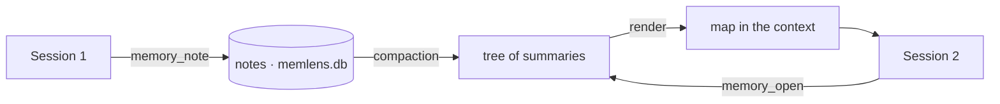

# memlens

[English](https://github.com/knopki/memlens/blob/HEAD/README.md) | [中文](https://github.com/knopki/memlens/blob/HEAD/README.zh.md) | Deutsch | [Español](https://github.com/knopki/memlens/blob/HEAD/README.es.md) | [Français](https://github.com/knopki/memlens/blob/HEAD/README.fr.md) | [日本語](https://github.com/knopki/memlens/blob/HEAD/README.ja.md) | [Português](https://github.com/knopki/memlens/blob/HEAD/README.pt.md) | [Русский](https://github.com/knopki/memlens/blob/HEAD/README.ru.md)

**Langzeitgedächtnis für einen Agenten.** Der Agent beginnt jede Sitzung mit einer Karte von dem,
was er schon weiß. Eine SQLite-Datei hält die Notizen, und ein Baum aus Zusammenfassungen steht
darüber.

<picture>
  <source media="(prefers-color-scheme: dark)" srcset="https://raw.githubusercontent.com/knopki/memlens/HEAD/docs/screenshots/console-overview-dark.png">
  
</picture>

## Das Problem

Ein Agent vergisst zwischen den Sitzungen. Eine neue Sitzung beginnt ohne einen Fakt aus den alten
Sitzungen. Ein längerer Chat ist kein Gedächtnis: Jedes Token kostet, und das Modell verliert den
Anfang trotzdem. Der Verlust zeigt sich an einem Projekt, das Wochen dauert: Der Agent fragt erneut
nach einer Entscheidung, und er wiederholt einen Fehler, den du schon behoben hast.

## Die Idee

memlens führt ein Notizbuch für den Agenten.

1. Der Agent schreibt eine Notiz: ein Fakt in 384 Zeichen, zum Beispiel eine Entscheidung oder eine
   Stolperfalle. Eine Notiz hat einen Scope, zum Beispiel `project:acme/billing`.
2. Der Speicher fasst zwei benachbarte Notizen zu einer Zeile zusammen. Zwei Zeilen werden wieder
   eine Zeile. Eine Zeile steht Wochen oder Jahre lang für ihre Notizen.
3. Zum Sitzungsstart bekommt der Agent eine Karte. Die Karte hält eine Zeile für jeden Scope und die
   Front des aktuellen Scopes vom ältesten Bereich bis zur neuesten Notiz.
4. Der Agent öffnet eine Zeile, die er braucht. Eine Zusammenfassung öffnet sich in die zwei Zeilen
   darunter. Eine Notiz öffnet sich Wort für Wort, mit ihrem Langdokument.

Ein Lesevorgang kostet keinen Modellaufruf. Eine Notiz kostet einen Modellaufruf in ihrem Leben,
wenn der Baum sie zusammenfasst.



## Was du bekommst

- **Ein kleiner Kontext, der klein bleibt.** Du gibst der Karte ein Budget in Zeilen. Zehn Notizen
  und zehntausend Notizen ergeben eine Karte gleicher Größe.
- **Lesen ohne Modellaufruf.** `memory_find` nutzt die Volltextsuche von SQLite. `memory_open` liest
  einen Datensatz. Das Modell antwortet nur, wenn der Baum zwei Notizen zusammenfasst.
- **Notizen, keine Nachrichten.** Jeder Eintrag ist ein Fakt, eine Entscheidung, eine Präferenz, eine
  Aufgabe oder eine Stolperfalle. Der Agent kuratiert die Notizen, also hält die Karte kein
  Chat-Rauschen.
- **Ein falscher Fakt ist eine Änderung in einer Zeile.** Die Konsole listet die Notizen, die zur
  Prüfung fällig sind. Du änderst eine Notiz, blendest sie aus oder schwärzt sie endgültig.
- **Eine Datei, kein Server.** Der Speicher ist eine SQLite-Datei. Der Befehl `memlens check` meldet
  den Zustand der Datei, und `memlens repair` baut die Caches aus den Datensätzen neu auf.
- **Jeder Agent sieht seine eigenen Scopes.** Ein Profil liefert eine Menge von Scopes und ein Budget.
  Ein Lese- oder Schreibvorgang außerhalb des Profils ergibt einen Fehler, also kann ein Projekt die
  Notizen eines anderen nicht lesen.
- **Drei Frontends auf einem Speicher.** Das Harness-Plugin, das Terminal und die Browser-Konsole
  lesen und schreiben dieselbe Datei.

## Eine Sitzung

Die Karte ist ein Abschnitt `<memory>` im Kontext des Agenten. Dieses Beispiel stammt aus einem
Speicher mit sieben Scopes. Der Richtlinienteil und die anderen Scope-Zeilen sind hier weggelassen:

```text
<memory>
…
<directions>
[project:acme/billing] 7d Billing runs an in-house invoice engine behind Stripe, prices in
price_book, and idempotency by invoice id. A trial ends at 23:59 in the customer zone. …
[work:ip] 3d The client pays on the 10th, and the invoice goes out on the 1st. The patent tax
rate is 6 percent, not 13. …
…
</directions>
<here scope="project:acme/billing">
#16-17 2026-09-18..22 The pilot started on 2026-09-15 with 3 customers.; A trial ends at 23:59
in the customer time zone, not in UTC.
#18 2026-09-24 A trial that ends on a Sunday starts dunning on Monday.
#19 2026-09-29 Stripe declines a card on a soft decline for 7 days.
#20 2026-10-02 Write the reconciliation script for the September close.
</here>
</memory>
```

Der Agent liest die Karte am Anfang. Dann sucht er, öffnet die Zeilen, die er braucht, und schreibt
neue Notizen, während die Arbeit läuft. Eine Adresse ist ein Scope und ein Slot, zum Beispiel
`project:acme/billing#19`. Der Befehl `memlens open` gibt die Notiz Wort für Wort, mit ihrem ganzen
Langdokument.

```console
$ memlens find "stripe"
project:acme/billing#19  2026-09-29  fact  Stripe declines a card on a soft decline for 7 days.
project:acme/billing#0  2026-08-04  decision  Stripe is the payment provider, and the invoice engine stays in house.
project:acme/billing#1  2026-08-05  gotcha  Stripe webhook retries arrive out of order, so the handler keys on the event id.
project:acme/billing#7  2026-08-21  decision  Every write to Stripe carries an idempotency key with the invoice id.

$ memlens open project:acme/billing#7
project:acme/billing#7  2026-08-21  decision  review 2027-11-25
Every write to Stripe carries an idempotency key with the invoice id.
--- longform 461 chars ---
# Idempotency on every Stripe write
…
```

## Verwendung in DeepSeek Harness

Die Karte und die Werkzeuge erreichen den Agenten über das Plugin. Der Speicher allein gibt einem
Agenten nichts. Füge das Plugin dem Profil des Hosts hinzu:

```sh
dsh plugin --profile web add @memlens/dsh-plugin
```

Das Plugin gibt dem Harness fünf Teile:

- **Die Karte.** Die Sitzung beginnt mit dem Abschnitt `<memory>` des Profils.
- **Die Werkzeuge.** Der Agent liest, schreibt und prüft die Notizen damit.
- **Der Hinweis.** Nach 10 Werkzeugaufrufen oder 10 Zügen erinnert der Harness den Agenten, eine
  Notiz zu speichern.
- **Der Worker.** Der Worker fasst die schmutzigen Bereiche über eine Modellroute des Harness
  zusammen.
- **Die Konsole.** Derselbe Client öffnet sich in der Seitenleiste und in einem Sitzungs-Tab.

### Die Werkzeuge

| Werkzeug        | Aktion                                                                   |
| --------------- | ------------------------------------------------------------------------ |
| `memory_find`   | Suche nach Wörtern, mit einer Grenze nach Datum, Art oder Scope.         |
| `memory_open`   | Eine Notiz über ihre Adresse öffnen, oder eine Zusammenfassung in die zwei Zeilen darunter öffnen. |
| `memory_note`   | Eine Notiz speichern.                                                    |
| `memory_map`    | Die Scopes auflisten oder die Front eines Scopes liefern.                |
| `memory_review` | Die zur Prüfung fälligen Notizen liefern, oder sie als geprüft markieren. |
| `memory_forget` | Eine Notiz ausblenden. Der Slot und der Inhalt bleiben, und die Notiz verlässt die Karte. |

Das Werkzeug `memory_note` beantwortet auch eine Wiederholung: Ein Schreibvorgang, der zu einer
aktiven Notiz passt, gibt diese Notiz, keinen zweiten Datensatz. Ein Subagent schreibt einen
Vorschlag statt einer aktiven Notiz, und ein Mensch nimmt den Vorschlag in der Konsole an. Der
Standardmodus eines Subagenten ist `propose`. Der Modus `read` gibt nur die Lesewerkzeuge, und der
Modus `off` gibt keinen Speicher.

### Die zwei Einstiegspunkte

Das Paket hält zwei Einstiegspunkte. Ein Profil montiert die Host-Zeile, und ein Agent-Preset
montiert die Preset-Zeile:

| Zeile            | Paket                       | Rolle                                                       |
| ---------------- | --------------------------- | ----------------------------------------------------------- |
| `memlens`        | `@memlens/dsh-plugin`       | Der Speicher, die Werkzeuge, die Karte, der Hinweis und der Worker. |
| `memlens/preset` | `@memlens/dsh-plugin/preset` | Das Speicherprofil eines Agent-Presets: die Scopes und das Budget. |

Ein Agent-Preset montiert die Preset-Zeile, um sein eigenes Profil und Budget zu wählen. Ohne die
Zeile nutzt der Agent das Profil, das `defaultProfile` nennt.

Die Verdichtung braucht eine Modellroute, und das Plugin wählt nie ein Modell. Die Schlüssel
`provider` und `model` der Host-Zeile ergeben diese Route:

```yaml
- insert:
    - id: memlens
      name: "@memlens/dsh-plugin"
      config:
        compaction:
          provider: deepseek-official
          model: deepseek-flash
```

Das Plugin liest dieselbe `config.toml` wie die CLI. Die Plugin-Zeile überschreibt die Basisdatei,
und die Preset-Zeile überschreibt die Plugin-Zeile. Jeder Schlüssel, sein Standardwert und ein
Beispiel stehen in [packages/dsh-plugin/README.md](https://github.com/knopki/memlens/blob/HEAD/packages/dsh-plugin/README.md).

## Verwendung im Terminal

```sh
npm install -g @memlens/cli
```

Die Installation gibt die Binärdatei `memlens`. Schreibe eine Notiz, finde sie und lies die Karte:

```sh
memlens note "The billing database is Postgres 16." --scope project:acme/billing
memlens find "database"
memlens slice
```

Der Befehl `npx @memlens/cli@latest` startet dieselbe Binärdatei ohne Installation:

```sh
npx @memlens/cli@latest find "database"
```

Der Speicher ist eine Datei `memlens.db` im Datenverzeichnis der Plattform. Die Option `--store` und
die Variable `MEMLENS_STORE` wählen ein anderes Verzeichnis. Die CLI und das Plugin nutzen denselben
Speicher, also liest das Terminal die Notizen einer laufenden Sitzung.

## Die Konsole

```sh
memlens ui
```

Die Konsole öffnet sich auf `http://127.0.0.1:7788`. Sie zeigt die Scopes, den Baum eines Scopes, die
Volltextsuche, die Warteschlange der Prüfung, die Vorschläge von Subagenten und das
Verdichtungsjournal.

<picture>
  <source media="(prefers-color-scheme: dark)" srcset="https://raw.githubusercontent.com/knopki/memlens/HEAD/docs/screenshots/console-review-dark.png">
  
</picture>

Derselbe Client öffnet sich in DeepSeek Harness, als Seitenleiste und als Sitzungs-Tab.

## Die Befehle

| Befehl               | Aktion                                                |
| -------------------- | ----------------------------------------------------- |
| `memlens note`       | Eine Notiz speichern.                                 |
| `memlens find`       | Die Notizen nach Wörtern durchsuchen.                 |
| `memlens open`       | Eine Notiz lesen oder die zwei Zeilen unter einer Zusammenfassung lesen. |
| `memlens slice`      | Die Karte drucken, die der Agent bekommt.             |
| `memlens review`     | Die fälligen Notizen auflisten oder sie als geprüft markieren. |
| `memlens compact`    | Einen Baulauf starten oder eine Antwortdatei anwenden. |
| `memlens ui`         | Die Konsole starten.                                  |

Die CLI gibt auch `amend`, `forget`, `restore`, `redact`, `move`, `import`, `export`, `check`,
`repair`, `journal` und `status`. Siehe [docs/architecture.md](https://github.com/knopki/memlens/blob/HEAD/docs/architecture.md).

## Konfiguration

memlens funktioniert ohne Konfigurationsdatei. Um einen Wert zu ändern, kopiere die Teile, die du
willst, in die Basisdatei:

| Plattform | Konfigurationsdatei                                 | Speicherdatei                                      |
| --------- | --------------------------------------------------- | -------------------------------------------------- |
| Linux     | `~/.config/memlens/config.toml`                     | `~/.local/share/memlens/memlens.db`                |
| macOS     | `~/Library/Application Support/memlens/config.toml` | `~/Library/Application Support/memlens/memlens.db` |
| Windows   | `%APPDATA%\memlens\config.toml`                     | `%LOCALAPPDATA%\memlens\memlens.db`                |

Ein absoluter `XDG_CONFIG_HOME` oder `XDG_DATA_HOME` überschreibt die Pfade von Linux.

```toml
defaultProfile = "default"

[profile.default]
scopes = ["*"]

[profile.default.budget]
here = 20
directions = 10
```

Der Schlüssel `here` ergibt die Zeilen des aktuellen Scopes. Der Schlüssel `directions` ergibt die
Zeilen der Scope-Liste. Das DSH-Plugin liest dieselbe Datei und fügt zwei eigene Ebenen hinzu. Der
Befehl `memlens config show` druckt die aufgelösten Werte, und er schreibt keine Datei. Jeder
Schlüssel, sein Standardwert und ein Beispiel stehen in
[docs/configuration.md](https://github.com/knopki/memlens/blob/HEAD/docs/configuration.md).

## Warum kein Chat-Protokoll

| Bedarf        | Ein Chat-Verlauf        | Ein Vektorspeicher        | memlens                                  |
| ------------- | ----------------------- | ------------------------- | ---------------------------------------- |
| Kontextkosten | Wächst mit dem Chat     | Ein paar Blöcke für eine Abfrage | Eine Zeile für jeden Scope, innerhalb eines Budgets |
| Wiederfinden  | Die genauen Wörter, bis das Modell sie verliert | Ähnlicher Text, ohne Reihenfolge | Die genauen Wörter über die Adresse, mit einem Datum |
| Kuratierung   | Keine                   | Keine                     | Der Agent schreibt, und du prüfst        |
| Ein falscher Fakt | Bleibt im Protokoll | Bleibt im Index           | Du blendest ihn aus oder schwärzt ihn    |

memlens hält keine Embeddings und keinen Vektorindex. Die Suche bleibt lexikalisch (SQLite FTS5), und
eine Notiz ist ein kuratierter Fakt. Der Speicher braucht keinen Server, kein Netzwerk und keine GPU.

## Status

Die Kernbibliothek, die CLI, die Konsole und das DSH-Plugin sind fertig, und die Prüfungen des
Repositories laufen durch. Die Verdichtung braucht ein Modell: Das Plugin sendet die
Zusammenführungsaufrufe über den Harness, und die CLI wartet auf eine Antwortdatei aus
`memlens compact`.

Der Quellcode steht auf [GitHub](https://github.com/knopki/memlens). Siehe [AGENTS.md](https://github.com/knopki/memlens/blob/HEAD/AGENTS.md)
für den Build, die Tests und die Arbeitsregeln des Repositories.

## Dokumente

| Datei                                       | Inhalt                                |
| ------------------------------------------- | ------------------------------------- |
| [docs/architecture.md](https://github.com/knopki/memlens/blob/HEAD/docs/architecture.md) | Wie das System arbeitet.             |
| [docs/configuration.md](https://github.com/knopki/memlens/blob/HEAD/docs/configuration.md) | Das Format der Konfiguration und Beispiele. |
| [packages/dsh-plugin/README.md](https://github.com/knopki/memlens/blob/HEAD/packages/dsh-plugin/README.md) | Das Plugin von DeepSeek Harness. |
| [docs/features](https://github.com/knopki/memlens/blob/HEAD/docs/features/README.md)    | Modulübergreifendes Verhalten als Szenarien. |
| [docs/arch/README.md](https://github.com/knopki/memlens/blob/HEAD/docs/arch/README.md)  | Das Architekturmodell als Diagramme.  |
| [AGENTS.md](https://github.com/knopki/memlens/blob/HEAD/AGENTS.md)                      | Arbeitsregeln für Agenten.            |

## Lizenz

MIT. Siehe [LICENSE](https://github.com/knopki/memlens/blob/HEAD/LICENSE).
