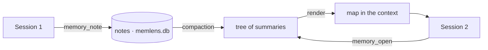

# memlens

[English](https://github.com/knopki/memlens/blob/HEAD/README.md) | [中文](https://github.com/knopki/memlens/blob/HEAD/README.zh.md) | [Deutsch](https://github.com/knopki/memlens/blob/HEAD/README.de.md) | Español | [Français](https://github.com/knopki/memlens/blob/HEAD/README.fr.md) | [日本語](https://github.com/knopki/memlens/blob/HEAD/README.ja.md) | [Português](https://github.com/knopki/memlens/blob/HEAD/README.pt.md) | [Русский](https://github.com/knopki/memlens/blob/HEAD/README.ru.md)

**Memoria a largo plazo para un agente.** El agente empieza cada sesión con un mapa de lo que ya
sabe. Un archivo SQLite guarda las notas, y un árbol de resúmenes se alza sobre ellas.

<p align="center">
  
</p>

## El problema

Un agente olvida entre sesiones. Una sesión nueva empieza sin ningún hecho de las sesiones viejas. Un
chat más largo no es una memoria: cada token cuesta, y el modelo sigue perdiendo el principio. La
pérdida se nota en un proyecto que dura semanas: el agente vuelve a preguntar por una decisión, y
repite un error que ya corregiste.

<picture>
  <source media="(prefers-color-scheme: dark)" srcset="https://raw.githubusercontent.com/knopki/memlens/HEAD/docs/screenshots/console-overview-dark.png">
  
</picture>

## La idea

memlens lleva un cuaderno para el agente.

1. El agente escribe una nota: un hecho en 384 caracteres, por ejemplo una decisión o una trampa. Una
   nota tiene un ámbito, por ejemplo `project:acme/billing`.
2. El almacén fusiona dos notas vecinas en una línea. Dos líneas se vuelven una línea otra vez. Una
   línea representa a sus notas durante semanas o años.
3. Al empezar la sesión el agente recibe un mapa. El mapa guarda una línea por cada ámbito, y la
   frontera del ámbito actual desde el rango más antiguo hasta la nota más reciente.
4. El agente abre una línea que necesita. Un resumen se abre en las dos líneas que están debajo. Una
   nota se abre palabra por palabra, con su documento largo.

Una lectura no cuesta ninguna llamada al modelo. Una nota cuesta una llamada al modelo en toda su
vida, cuando el árbol la fusiona.



## Lo que obtienes

- **Un contexto pequeño que sigue pequeño.** Le das al mapa un presupuesto en líneas. Diez notas y
  diez mil notas dan un mapa del mismo tamaño.
- **Lecturas sin llamada al modelo.** `memory_find` usa la búsqueda de texto completo de SQLite.
  `memory_open` lee una fila. El modelo responde solo cuando el árbol fusiona dos notas.
- **Notas, no mensajes.** Cada entrada es un hecho, una decisión, una preferencia, una tarea o una
  trampa. El agente cura las notas, así que el mapa no guarda ruido de chat.
- **Un hecho erróneo es una edición de una línea.** La consola lista las notas pendientes de
  revisión. Modificas una nota, la ocultas o la censuras para siempre.
- **Un archivo, sin servidor.** El almacén es un archivo SQLite. El comando `memlens check` informa
  de la salud del archivo, y `memlens repair` reconstruye las cachés desde las filas.
- **Cada agente ve sus propios ámbitos.** Un perfil da un conjunto de ámbitos y un presupuesto. Una
  lectura o una escritura fuera del perfil da un error, así que un proyecto no puede leer las notas
  de otro.
- **Tres frontends sobre un almacén.** El plugin del harness, la terminal y la consola del navegador
  leen y escriben el mismo archivo.

## Una sesión

El mapa es una sección `<memory>` en el contexto del agente. Este ejemplo viene de una memoria de
siete ámbitos. La parte de política y las otras líneas de ámbito están recortadas aquí:

```text
<memory>
…
<directions>
[project:acme/billing] 7d Billing runs an in-house invoice engine behind Stripe, prices in
price_book, and idempotency by invoice id. A trial ends at 23:59 in the customer zone. …
[work:ip] 3d The client pays on the 10th, and the invoice goes out on the 1st. The patent tax
rate is 6 percent, not 13. …
…
</directions>
<here scope="project:acme/billing">
#16-17 2026-09-18..22 The pilot started on 2026-09-15 with 3 customers.; A trial ends at 23:59
in the customer time zone, not in UTC.
#18 2026-09-24 A trial that ends on a Sunday starts dunning on Monday.
#19 2026-09-29 Stripe declines a card on a soft decline for 7 days.
#20 2026-10-02 Write the reconciliation script for the September close.
</here>
</memory>
```

El agente lee el mapa al principio. Luego busca, abre las líneas que necesita y escribe notas nuevas
según avanza el trabajo. Una dirección es un ámbito y una posición, por ejemplo
`project:acme/billing#19`. El comando `memlens open` da la nota palabra por palabra, con todo su
documento largo.

```console
$ memlens find "stripe"
project:acme/billing#19  2026-09-29  fact  Stripe declines a card on a soft decline for 7 days.
project:acme/billing#0  2026-08-04  decision  Stripe is the payment provider, and the invoice engine stays in house.
project:acme/billing#1  2026-08-05  gotcha  Stripe webhook retries arrive out of order, so the handler keys on the event id.
project:acme/billing#7  2026-08-21  decision  Every write to Stripe carries an idempotency key with the invoice id.

$ memlens open project:acme/billing#7
project:acme/billing#7  2026-08-21  decision  review 2027-11-25
Every write to Stripe carries an idempotency key with the invoice id.
--- longform 461 chars ---
# Idempotency on every Stripe write
…
```

## Úsalo en DeepSeek Harness

El mapa y las herramientas llegan al agente a través del plugin. El almacén por sí solo no le da nada
a un agente. Añade el plugin al perfil del host:

```sh
dsh plugin --profile web add @memlens/dsh-plugin
```

El plugin da al harness cinco partes:

- **El mapa.** La sesión empieza con la sección `<memory>` del perfil.
- **Las herramientas.** El agente lee, escribe y revisa las notas con ellas.
- **El aviso.** Después de 10 llamadas de herramientas o 10 turnos, el harness recuerda al agente que
  guarde una nota.
- **El worker.** El worker fusiona los rangos pendientes a través de una ruta de modelo del harness.
- **La consola.** El mismo cliente se abre en el panel lateral y en una pestaña de sesión.

### Las herramientas

| Herramienta     | Acción                                                                           |
| --------------- | -------------------------------------------------------------------------------- |
| `memory_find`   | Busca por palabras, con un límite por fecha, tipo o ámbito.                      |
| `memory_open`   | Abre una nota por su dirección, o un resumen en las dos líneas de debajo.        |
| `memory_note`   | Guarda una nota.                                                                 |
| `memory_map`    | Lista los ámbitos, o da la frontera de un ámbito.                                |
| `memory_review` | Da las notas pendientes de revisión, o las marca como revisadas.                 |
| `memory_forget` | Oculta una nota. La posición y el contenido permanecen, y la nota sale del mapa. |

La herramienta `memory_note` también responde a una repetición: una escritura que coincide con una
nota activa da esa nota, no una segunda fila. Un subagente escribe una propuesta en lugar de una nota
activa, y una persona acepta la propuesta en la consola. El modo por defecto de un subagente es
`propose`. El modo `read` da solo las herramientas de lectura, y el modo `off` no da memoria.

### Las dos entradas

El paquete tiene dos entradas. Un perfil monta la fila del host, y un preset de agente monta la fila
del preset:

| Fila             | Paquete                      | Función                                                                    |
| ---------------- | ---------------------------- | -------------------------------------------------------------------------- |
| `memlens`        | `@memlens/dsh-plugin`        | El almacén, las herramientas, el mapa, el aviso y el worker.               |
| `memlens/preset` | `@memlens/dsh-plugin/preset` | El perfil de memoria de un preset de agente: los ámbitos y el presupuesto. |

Un preset de agente monta la fila del preset para seleccionar su propio perfil y su presupuesto. Sin
la fila, el agente usa el perfil que nombra `defaultProfile`.

La compactación necesita una ruta de modelo, y el plugin nunca elige un modelo. Las claves `provider`
y `model` de la fila del host dan esa ruta:

```yaml
- insert:
    - id: memlens
      name: "@memlens/dsh-plugin"
      config:
        compaction:
          provider: deepseek-official
          model: deepseek-flash
```

El plugin lee el mismo `config.toml` que la CLI. La fila del plugin sobrescribe el archivo base, y la
fila del preset sobrescribe la fila del plugin. Consulta cada clave, su valor por defecto y ejemplos
en [packages/dsh-plugin/README.md](https://github.com/knopki/memlens/blob/HEAD/packages/dsh-plugin/README.md).

## Úsalo en una terminal

```sh
npm install -g @memlens/cli
```

La instalación da el binario `memlens`. Escribe una nota, encuéntrala y lee el mapa:

```sh
memlens note "The billing database is Postgres 16." --scope project:acme/billing
memlens find "database"
memlens slice
```

El comando `npx @memlens/cli@latest` ejecuta el mismo binario sin instalación:

```sh
npx @memlens/cli@latest find "database"
```

El almacén es un archivo `memlens.db` en el directorio de datos de la plataforma. El flag `--store` y
la variable `MEMLENS_STORE` seleccionan otro directorio. La CLI y el plugin usan el mismo almacén,
así que la terminal lee las notas de una sesión activa.

## La consola

```sh
memlens ui
```

La consola se abre en `http://127.0.0.1:7788`. Muestra los ámbitos, el árbol de un ámbito, la
búsqueda de texto completo, la cola de revisión, las propuestas de los subagentes y el diario del
worker.

<picture>
  <source media="(prefers-color-scheme: dark)" srcset="https://raw.githubusercontent.com/knopki/memlens/HEAD/docs/screenshots/console-review-dark.png">
  
</picture>

El mismo cliente se abre dentro de DeepSeek Harness, como panel lateral y como pestaña de sesión.

## Los comandos

| Comando           | Acción                                                                |
| ----------------- | --------------------------------------------------------------------- |
| `memlens note`    | Guarda una nota.                                                      |
| `memlens find`    | Busca las notas por palabras.                                         |
| `memlens open`    | Lee una nota, o las dos líneas que están debajo de un resumen.        |
| `memlens slice`   | Imprime el mapa que recibe el agente.                                 |
| `memlens review`  | Lista las notas pendientes, o las marca como revisadas.               |
| `memlens compact` | Inicia una construcción del árbol, o aplica un archivo de respuestas. |
| `memlens ui`      | Inicia la consola.                                                    |

La CLI también da `amend`, `forget`, `restore`, `redact`, `move`, `import`, `export`, `check`,
`repair`, `journal` y `status`. Consulta [docs/architecture.md](https://github.com/knopki/memlens/blob/HEAD/docs/architecture.md).

## Configuración

memlens funciona sin archivo de configuración. Para cambiar un valor, copia las partes que quieras en
el archivo base:

| Plataforma | Archivo de configuración                            | Archivo del almacén                                |
| ---------- | --------------------------------------------------- | -------------------------------------------------- |
| Linux      | `~/.config/memlens/config.toml`                     | `~/.local/share/memlens/memlens.db`                |
| macOS      | `~/Library/Application Support/memlens/config.toml` | `~/Library/Application Support/memlens/memlens.db` |
| Windows    | `%APPDATA%\memlens\config.toml`                     | `%LOCALAPPDATA%\memlens\memlens.db`                |

Un valor absoluto de `XDG_CONFIG_HOME` o de `XDG_DATA_HOME` sobrescribe las rutas de Linux.

```toml
defaultProfile = "default"

[profile.default]
scopes = ["*"]

[profile.default.budget]
here = 20
directions = 10
```

La clave `here` da las líneas del ámbito actual. La clave `directions` da las líneas de la lista de
ámbitos. El plugin de DSH lee el mismo archivo y añade dos capas propias. El comando
`memlens config show` imprime los valores resueltos, y no escribe ningún archivo. Consulta cada
clave, su valor por defecto y ejemplos en [docs/configuration.md](https://github.com/knopki/memlens/blob/HEAD/docs/configuration.md).

## Por qué no un registro de chat

| Necesidad         | Un historial de chat                                 | Un almacén vectorial         | memlens                                             |
| ----------------- | ---------------------------------------------------- | ---------------------------- | --------------------------------------------------- |
| Coste de contexto | Crece con el chat                                    | Unos fragmentos por consulta | Una línea por cada ámbito, dentro de un presupuesto |
| Recuperación      | Las palabras exactas, hasta que el modelo las pierde | Texto similar, sin orden     | Las palabras exactas por dirección, con una fecha   |
| Curación          | Ninguna                                              | Ninguna                      | El agente escribe, y tú revisas                     |
| Un hecho erróneo  | Se queda en el registro                              | Se queda en el índice        | Lo ocultas o lo censuras                            |

memlens no guarda embeddings ni ningún índice vectorial. La búsqueda sigue siendo léxica (SQLite
FTS5), y una nota es un hecho curado. El almacén no necesita servidor, ni red, ni GPU.

## Estado

La biblioteca del núcleo, la CLI, la consola y el plugin de DSH están listos, y las comprobaciones del
repositorio pasan. La compactación necesita un modelo: el plugin envía las llamadas de fusión a través
del harness, y la CLI espera un archivo de respuestas de `memlens compact`.

El código fuente está en [GitHub](https://github.com/knopki/memlens). Consulta [AGENTS.md](https://github.com/knopki/memlens/blob/HEAD/AGENTS.md) para la
compilación, las pruebas y las reglas de trabajo del repositorio.

## Documentos

| Archivo                                                        | Contenido                                        |
| -------------------------------------------------------------- | ------------------------------------------------ |
| [docs/architecture.md](https://github.com/knopki/memlens/blob/HEAD/docs/architecture.md)                   | Cómo funciona el sistema.                        |
| [docs/configuration.md](https://github.com/knopki/memlens/blob/HEAD/docs/configuration.md)                 | El formato de configuración y ejemplos.          |
| [packages/dsh-plugin/README.md](https://github.com/knopki/memlens/blob/HEAD/packages/dsh-plugin/README.md) | El plugin de DeepSeek Harness.                   |
| [docs/features](https://github.com/knopki/memlens/blob/HEAD/docs/features/README.md)                       | El comportamiento entre módulos como escenarios. |
| [docs/arch/README.md](https://github.com/knopki/memlens/blob/HEAD/docs/arch/README.md)                     | El modelo de arquitectura como diagramas.        |
| [AGENTS.md](https://github.com/knopki/memlens/blob/HEAD/AGENTS.md)                                         | Las reglas de trabajo para agentes.              |

## Licencia

MIT. Consulta [LICENSE](https://github.com/knopki/memlens/blob/HEAD/LICENSE).
