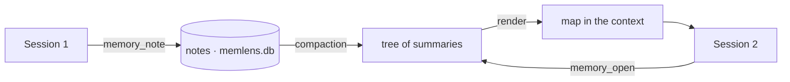

# memlens

[English](https://github.com/knopki/memlens/blob/HEAD/README.md) | [中文](https://github.com/knopki/memlens/blob/HEAD/README.zh.md) | [Deutsch](https://github.com/knopki/memlens/blob/HEAD/README.de.md) | [Español](https://github.com/knopki/memlens/blob/HEAD/README.es.md) | Français | [日本語](https://github.com/knopki/memlens/blob/HEAD/README.ja.md) | [Português](https://github.com/knopki/memlens/blob/HEAD/README.pt.md) | [Русский](https://github.com/knopki/memlens/blob/HEAD/README.ru.md)

**La mémoire à long terme d'un agent.** L'agent commence chaque session avec une carte de ce qu'il
sait déjà. Un fichier SQLite tient les notes, et un arbre de résumés se dresse au-dessus d'elles.

<p align="center">
  
</p>

## Le problème

Un agent oublie d'une session à l'autre. Une nouvelle session démarre sans aucun fait des anciennes.
Un long chat n'est pas une mémoire : chaque jeton coûte, et le modèle perd quand même le début. La
perte se voit sur un projet qui dure des semaines : l'agent redemande une décision, et il répète une
erreur que tu as déjà corrigée.

<picture>
  <source media="(prefers-color-scheme: dark)" srcset="https://raw.githubusercontent.com/knopki/memlens/HEAD/docs/screenshots/console-overview-dark.png">
  
</picture>

## L'idée

memlens tient un carnet pour l'agent.

1. L'agent écrit une note : un fait en 384 caractères, par exemple une décision ou un piège. Une note
   a une portée, par exemple `project:acme/billing`.
2. Le stockage replie deux notes voisines en une ligne. Deux lignes redeviennent une ligne. Une ligne
   tient lieu de ses notes pendant des semaines ou des années.
3. Au début de la session, l'agent reçoit une carte. La carte tient une ligne pour chaque portée, et
   la frontière de la portée courante, de la plus ancienne plage à la note la plus récente.
4. L'agent ouvre une ligne dont il a besoin. Un résumé s'ouvre sur les deux lignes en dessous. Une
   note s'ouvre mot pour mot, avec son document de forme longue.

Une lecture ne coûte aucun appel de modèle. Une note coûte un appel de modèle dans sa vie, quand
l'arbre la fusionne.



## Ce que tu obtiens

- **Un petit contexte qui reste petit.** Tu donnes à la carte un budget en lignes. Dix notes et dix
  mille notes donnent une carte de la même taille.
- **Des lectures sans appel de modèle.** `memory_find` utilise la recherche plein texte de SQLite.
  `memory_open` lit une ligne. Le modèle répond seulement quand l'arbre fusionne deux notes.
- **Des notes, pas des messages.** Chaque entrée est un fait, une décision, une préférence, une tâche
  ou un piège. L'agent sélectionne les notes, donc la carte ne contient aucun bruit de chat.
- **Un fait faux se corrige en une ligne.** La console liste les notes à réviser. Tu modifies une
  note, tu la masques ou tu l'expurges pour de bon.
- **Un fichier, aucun serveur.** Le stockage est un fichier SQLite. La commande `memlens check`
  rapporte la santé du fichier, et `memlens repair` reconstruit les caches depuis les lignes.
- **Chaque agent voit ses propres portées.** Un profil donne un ensemble de portées et un budget. Une
  lecture ou une écriture hors du profil donne une erreur, donc un projet ne peut pas lire les notes
  d'un autre.
- **Trois interfaces sur un stockage.** Le plugin du harness, le terminal et la console du navigateur
  lisent et écrivent le même fichier.

## Une session

La carte est une section `<memory>` dans le contexte de l'agent. Cet exemple vient d'une mémoire de
sept portées. Le texte de politique et les autres lignes de portée sont coupés ici :

```text
<memory>
…
<directions>
[project:acme/billing] 7d Billing runs an in-house invoice engine behind Stripe, prices in
price_book, and idempotency by invoice id. A trial ends at 23:59 in the customer zone. …
[work:ip] 3d The client pays on the 10th, and the invoice goes out on the 1st. The patent tax
rate is 6 percent, not 13. …
…
</directions>
<here scope="project:acme/billing">
#16-17 2026-09-18..22 The pilot started on 2026-09-15 with 3 customers.; A trial ends at 23:59
in the customer time zone, not in UTC.
#18 2026-09-24 A trial that ends on a Sunday starts dunning on Monday.
#19 2026-09-29 Stripe declines a card on a soft decline for 7 days.
#20 2026-10-02 Write the reconciliation script for the September close.
</here>
</memory>
```

L'agent lit la carte au début. Il cherche ensuite, ouvre les lignes dont il a besoin et écrit de
nouvelles notes au fil du travail. Une adresse est une portée et un emplacement, par exemple
`project:acme/billing#19`. La commande `memlens open` donne la note mot pour mot, avec tout son
document de forme longue.

```console
$ memlens find "stripe"
project:acme/billing#19  2026-09-29  fact  Stripe declines a card on a soft decline for 7 days.
project:acme/billing#0  2026-08-04  decision  Stripe is the payment provider, and the invoice engine stays in house.
project:acme/billing#1  2026-08-05  gotcha  Stripe webhook retries arrive out of order, so the handler keys on the event id.
project:acme/billing#7  2026-08-21  decision  Every write to Stripe carries an idempotency key with the invoice id.

$ memlens open project:acme/billing#7
project:acme/billing#7  2026-08-21  decision  review 2027-11-25
Every write to Stripe carries an idempotency key with the invoice id.
--- longform 461 chars ---
# Idempotency on every Stripe write
…
```

## L'utiliser dans DeepSeek Harness

La carte et les outils atteignent l'agent par le plugin. Le stockage seul ne donne rien à un agent.
Ajoute le plugin au profil de l'hôte :

```sh
dsh plugin --profile web add @memlens/dsh-plugin
```

Le plugin donne cinq parties au harness :

- **La carte.** La session démarre avec la section `<memory>` du profil.
- **Les outils.** L'agent lit, écrit et révise les notes avec eux.
- **Le rappel.** Après 10 appels d'outil ou 10 tours, le harness rappelle à l'agent de
  consigner une note.
- **Le travailleur.** Le travailleur fusionne les plages sales par une route de modèle du harness.
- **La console.** Le même client s'ouvre dans le panneau latéral et dans un onglet de session.

### Les outils

| Outil           | Action                                                                             |
| --------------- | ---------------------------------------------------------------------------------- |
| `memory_find`   | Chercher par mots, avec une limite par date, type ou portée.                       |
| `memory_open`   | Ouvrir une note par son adresse, ou un résumé sur les deux lignes en dessous.      |
| `memory_note`   | Consigner une note.                                                                |
| `memory_map`    | Lister les portées, ou donner la frontière d'une portée.                           |
| `memory_review` | Donner les notes à réviser, ou les marquer comme révisées.                         |
| `memory_forget` | Masquer une note. L'emplacement et le contenu restent, et la note quitte la carte. |

L'outil `memory_note` répond aussi à un doublon : une écriture qui correspond à une note active donne
cette note, pas une seconde ligne. Un sous-agent écrit une proposition au lieu d'une note active, et
un humain accepte la proposition dans la console. Le mode par défaut d'un sous-agent est `propose`.
Le mode `read` donne seulement les outils de lecture, et le mode `off` ne donne aucune mémoire.

### Les deux points d'entrée

Le paquet porte deux points d'entrée. Un profil monte la ligne hôte, et un préréglage d'agent monte la
ligne de préréglage :

| Ligne            | Paquet                       | Rôle                                                                     |
| ---------------- | ---------------------------- | ------------------------------------------------------------------------ |
| `memlens`        | `@memlens/dsh-plugin`        | Le stockage, les outils, la carte, le rappel et le travailleur.          |
| `memlens/preset` | `@memlens/dsh-plugin/preset` | Le profil de mémoire d'un préréglage d'agent : les portées et le budget. |

Un préréglage d'agent monte la ligne de préréglage pour choisir son propre profil et son budget. Sans
la ligne, l'agent utilise le profil que nomme `defaultProfile`.

La compaction a besoin d'une route de modèle, et le plugin ne choisit jamais de modèle. Les clés
`provider` et `model` de la ligne hôte donnent cette route :

```yaml
- insert:
    - id: memlens
      name: "@memlens/dsh-plugin"
      config:
        compaction:
          provider: deepseek-official
          model: deepseek-flash
```

Le plugin lit le même `config.toml` que la CLI. La ligne du plugin remplace le fichier de base, et la
ligne de préréglage remplace la ligne du plugin. Vois chaque clé, sa valeur par défaut et un exemple
dans [packages/dsh-plugin/README.md](https://github.com/knopki/memlens/blob/HEAD/packages/dsh-plugin/README.md).

## L'utiliser dans un terminal

```sh
npm install -g @memlens/cli
```

L'installation donne le binaire `memlens`. Écris une note, retrouve-la et lis la carte :

```sh
memlens note "The billing database is Postgres 16." --scope project:acme/billing
memlens find "database"
memlens slice
```

La commande `npx @memlens/cli@latest` lance le même binaire sans installation :

```sh
npx @memlens/cli@latest find "database"
```

Le stockage est un fichier `memlens.db` dans le répertoire de données de la plateforme. L'option
`--store` et la variable `MEMLENS_STORE` choisissent un autre répertoire. La CLI et le plugin
utilisent le même stockage, donc le terminal lit les notes d'une session en cours.

## La console

```sh
memlens ui
```

La console s'ouvre sur `http://127.0.0.1:7788`. Elle montre les portées, l'arbre d'une portée, la
recherche plein texte, la file de révision, les propositions des sous-agents et le journal du
travailleur.

<picture>
  <source media="(prefers-color-scheme: dark)" srcset="https://raw.githubusercontent.com/knopki/memlens/HEAD/docs/screenshots/console-review-dark.png">
  
</picture>

Le même client s'ouvre dans DeepSeek Harness, comme panneau latéral et comme onglet de session.

## Les commandes

| Commande          | Action                                                                 |
| ----------------- | ---------------------------------------------------------------------- |
| `memlens note`    | Consigner une note.                                                    |
| `memlens find`    | Chercher les notes par mots.                                           |
| `memlens open`    | Lire une note, ou les deux lignes sous un résumé.                      |
| `memlens slice`   | Afficher la carte que l'agent reçoit.                                  |
| `memlens review`  | Lister les notes dues, ou les marquer comme révisées.                  |
| `memlens compact` | Démarrer une construction d'arbre, ou appliquer un fichier de réponse. |
| `memlens ui`      | Démarrer la console.                                                   |

La CLI donne aussi `amend`, `forget`, `restore`, `redact`, `move`, `import`, `export`, `check`,
`repair`, `journal` et `status`. Vois [docs/architecture.md](https://github.com/knopki/memlens/blob/HEAD/docs/architecture.md).

## Configuration

memlens fonctionne sans fichier de configuration. Pour changer une valeur, copie les parties que tu
veux dans le fichier de base :

| Plateforme | Fichier de configuration                            | Fichier de stockage                                |
| ---------- | --------------------------------------------------- | -------------------------------------------------- |
| Linux      | `~/.config/memlens/config.toml`                     | `~/.local/share/memlens/memlens.db`                |
| macOS      | `~/Library/Application Support/memlens/config.toml` | `~/Library/Application Support/memlens/memlens.db` |
| Windows    | `%APPDATA%\memlens\config.toml`                     | `%LOCALAPPDATA%\memlens\memlens.db`                |

Un `XDG_CONFIG_HOME` ou un `XDG_DATA_HOME` absolu remplace les chemins de Linux.

```toml
defaultProfile = "default"

[profile.default]
scopes = ["*"]

[profile.default.budget]
here = 20
directions = 10
```

La clé `here` donne les lignes de la portée courante. La clé `directions` donne les lignes de la
liste des portées. Le plugin DSH lit le même fichier et ajoute deux couches qui lui sont propres. La
commande `memlens config show` affiche les valeurs résolues, et elle n'écrit aucun fichier. Vois
chaque clé, sa valeur par défaut et un exemple dans [docs/configuration.md](https://github.com/knopki/memlens/blob/HEAD/docs/configuration.md).

## Pourquoi pas un journal de chat

| Besoin           | Un historique de chat                               | Un stockage vectoriel              | memlens                                      |
| ---------------- | --------------------------------------------------- | ---------------------------------- | -------------------------------------------- |
| Coût du contexte | Croît avec le chat                                  | Quelques morceaux pour une requête | Une ligne pour chaque portée, dans un budget |
| Restitution      | Les mots exacts, jusqu'à ce que le modèle les perde | Un texte similaire, sans ordre     | Les mots exacts par adresse, avec une date   |
| Sélection        | Aucune                                              | Aucune                             | L'agent écrit, et tu révises                 |
| Un fait faux     | Reste dans le journal                               | Reste dans l'index                 | Tu le masques ou tu l'expurges               |

memlens ne garde aucun plongement et aucun index vectoriel. La recherche reste lexicale (SQLite
FTS5), et une note est un fait retenu. Le stockage n'a besoin d'aucun serveur, d'aucun réseau et
d'aucun GPU.

## État

La bibliothèque centrale, la CLI, la console et le plugin DSH sont prêts, et les vérifications du
dépôt passent. La compaction a besoin d'un modèle : le plugin envoie les appels de fusion par le
harness, et la CLI attend un fichier de réponse de `memlens compact`.

Les sources sont sur [GitHub](https://github.com/knopki/memlens). Vois [AGENTS.md](https://github.com/knopki/memlens/blob/HEAD/AGENTS.md) pour la
compilation, les tests et les règles de travail du dépôt.

## Documents

| Fichier                                                        | Contenu                                     |
| -------------------------------------------------------------- | ------------------------------------------- |
| [docs/architecture.md](https://github.com/knopki/memlens/blob/HEAD/docs/architecture.md)                   | Comment le système fonctionne.              |
| [docs/configuration.md](https://github.com/knopki/memlens/blob/HEAD/docs/configuration.md)                 | Le format de configuration et des exemples. |
| [packages/dsh-plugin/README.md](https://github.com/knopki/memlens/blob/HEAD/packages/dsh-plugin/README.md) | Le plugin de DeepSeek Harness.              |
| [docs/features](https://github.com/knopki/memlens/blob/HEAD/docs/features/README.md)                       | Le comportement entre modules en scénarios. |
| [docs/arch/README.md](https://github.com/knopki/memlens/blob/HEAD/docs/arch/README.md)                     | Le modèle d'architecture en diagrammes.     |
| [AGENTS.md](https://github.com/knopki/memlens/blob/HEAD/AGENTS.md)                                         | Les règles de travail pour les agents.      |

## Licence

MIT. Vois [LICENSE](https://github.com/knopki/memlens/blob/HEAD/LICENSE).
