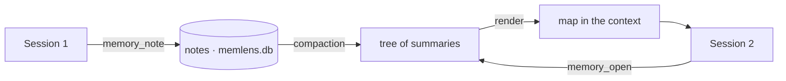

# memlens

[English](https://github.com/knopki/memlens/blob/HEAD/README.md) | [中文](https://github.com/knopki/memlens/blob/HEAD/README.zh.md) | [Deutsch](https://github.com/knopki/memlens/blob/HEAD/README.de.md) | [Español](https://github.com/knopki/memlens/blob/HEAD/README.es.md) | [Français](https://github.com/knopki/memlens/blob/HEAD/README.fr.md) | 日本語 | [Português](https://github.com/knopki/memlens/blob/HEAD/README.pt.md) | [Русский](https://github.com/knopki/memlens/blob/HEAD/README.ru.md)

**エージェントのための長期記憶です。** エージェントは各セッションを、すでに
知っていることのマップとともに始めます。1 つの SQLite ファイルがノートを
保持し、その上に要約のツリーが立ちます。

<picture>
  <source media="(prefers-color-scheme: dark)" srcset="https://raw.githubusercontent.com/knopki/memlens/HEAD/docs/screenshots/console-overview-dark.png">
  
</picture>

## 問題

エージェントはセッションの間で忘れます。新しいセッションは、古いセッションの事実を
1 つも持たずに始まります。長いチャットは記憶ではありません。トークンごとに
コストがかかり、それでもモデルは冒頭を失います。この損失は数週間続くプロジェクトで
現れます。エージェントは同じ決定を再び尋ね、すでに直した間違いを繰り返します。

## アイデア

memlens はエージェントのためのノートブックを保持します。

1. エージェントはノートを書きます。384 文字で 1 つの事実、たとえば決定や
   落とし穴です。ノートはスコープを持ち、たとえば `project:acme/billing` です。
2. ストアは隣り合う 2 つのノートを 1 行にまとめます。2 行は再び 1 行になります。
   1 行は数週間または数年にわたり、そのノートの代わりになります。
3. セッションの開始時に、エージェントはマップを受け取ります。マップは
   スコープごとに 1 行を持ち、現在のスコープのフロンティアを、最古の範囲から
   最新のノートまで含みます。
4. エージェントは必要な行を開きます。要約はその下の 2 行に開きます。ノートは
   長文ドキュメントとともに、語句そのままに開きます。

読み取りはモデル呼び出しを消費しません。ノートは生涯で 1 回だけ
モデル呼び出しを消費し、そのときツリーがそのノートを統合します。



## 得られるもの

- **小さく保たれるコンテキスト。** マップには行数でバジェットを与えます。10 件の
  ノートでも 1 万件のノートでも、マップの大きさは同じです。
- **モデル呼び出しなしの読み取り。** `memory_find` は SQLite の全文検索を
  使います。`memory_open` は 1 行を読みます。モデルが答えるのは、ツリーが
  2 つのノートを統合するときだけです。
- **メッセージではなくノート。** 各エントリは事実、決定、好み、タスク、または
  落とし穴です。エージェントがノートを選別するため、マップにチャットの雑音は
  入りません。
- **誤った事実は 1 行の修正です。** コンソールはレビューの期限が来たノートを
  一覧します。ノートを変更し、非表示にし、または完全に秘匿化します。
- **1 つのファイル、サーバーなし。** ストアは 1 つの SQLite ファイルです。
  コマンド `memlens check` はファイルの健全性を報告し、`memlens repair` は行から
  キャッシュを再構築します。
- **各エージェントは自分のスコープを見ます。** プロファイルはスコープの集合と
  バジェットを与えます。プロファイルの外への読み取りや書き込みはエラーに
  なるため、あるプロジェクトが別のプロジェクトのノートを読むことはできません。
- **1 つのストアに 3 つのフロントエンド。** ハーネスのプラグイン、ターミナル、
  ブラウザのコンソールが同じファイルを読み書きします。

## セッション

マップは、エージェントのコンテキストにある 1 つの `<memory>` セクションです。
この例は 7 つのスコープを持つメモリから来ています。ここではポリシーの部分と
他のスコープの行を省きます:

```text
<memory>
…
<directions>
[project:acme/billing] 7d Billing runs an in-house invoice engine behind Stripe, prices in
price_book, and idempotency by invoice id. A trial ends at 23:59 in the customer zone. …
[work:ip] 3d The client pays on the 10th, and the invoice goes out on the 1st. The patent tax
rate is 6 percent, not 13. …
…
</directions>
<here scope="project:acme/billing">
#16-17 2026-09-18..22 The pilot started on 2026-09-15 with 3 customers.; A trial ends at 23:59
in the customer time zone, not in UTC.
#18 2026-09-24 A trial that ends on a Sunday starts dunning on Monday.
#19 2026-09-29 Stripe declines a card on a soft decline for 7 days.
#20 2026-10-02 Write the reconciliation script for the September close.
</here>
</memory>
```

エージェントは開始時にマップを読みます。その後は検索し、必要な行を開き、作業
の進行に合わせて新しいノートを書きます。アドレスはスコープとスロットで、
たとえば `project:acme/billing#19` です。コマンド `memlens open` は
ノートを、長文ドキュメント全体とともに語句そのままに返します。

```console
$ memlens find "stripe"
project:acme/billing#19  2026-09-29  fact  Stripe declines a card on a soft decline for 7 days.
project:acme/billing#0  2026-08-04  decision  Stripe is the payment provider, and the invoice engine stays in house.
project:acme/billing#1  2026-08-05  gotcha  Stripe webhook retries arrive out of order, so the handler keys on the event id.
project:acme/billing#7  2026-08-21  decision  Every write to Stripe carries an idempotency key with the invoice id.

$ memlens open project:acme/billing#7
project:acme/billing#7  2026-08-21  decision  review 2027-11-25
Every write to Stripe carries an idempotency key with the invoice id.
--- longform 461 chars ---
# Idempotency on every Stripe write
…
```

## DeepSeek Harness で使う

マップとツールはプラグインを通じてエージェントに届きます。ストアだけでは
エージェントに何も与えません。ホストのプロファイルにプラグインを追加します:

```sh
dsh plugin --profile web add @memlens/dsh-plugin
```

プラグインはハーネスに 5 つの部分を与えます:

- **マップ。** セッションはプロファイルの `<memory>` セクションとともに始まります。
- **ツール。** エージェントはこれらでノートを読み、書き、レビューします。
- **ナッジ。** ツール呼び出し 10 回またはターン 10 回の後に、ハーネスはノートの
  保存をエージェントに促します。
- **ワーカー。** ワーカーはダーティ範囲を、ハーネスのモデルルート経由で統合します。
- **コンソール。** 同じクライアントがサイドパネルとセッションタブで開きます。

### ツール

| ツール          | 動作                                                                       |
| --------------- | -------------------------------------------------------------------------- |
| `memory_find`   | 単語で検索し、日付、種類、またはスコープで上限をかけます。                 |
| `memory_open`   | アドレスでノートを開くか、要約をその下の 2 行に開きます。                  |
| `memory_note`   | ノートを 1 つ保存します。                                                  |
| `memory_map`    | スコープを一覧するか、1 つのスコープのフロンティアを返します。             |
| `memory_review` | レビューの期限が来たノートを返すか、レビュー済みにします。                 |
| `memory_forget` | ノートを非表示にします。スロットと内容は残り、ノートはマップから外れます。 |

ツール `memory_note` は繰り返しにも答えます。有効なノートに一致する書き込みは、
2 行目ではなくそのノートを返します。サブエージェントは有効なノートではなく
提案を書き、人間がコンソールでその提案を承認します。サブエージェントの既定の
モードは `propose` です。モード `read` は読み取りツールだけを与え、モード
`off` はメモリを与えません。

### 2 つのエントリ

パッケージは 2 つのエントリを持ちます。プロファイルはホスト行をマウントし、
エージェントプリセットはプリセット行をマウントします:

| 行               | パッケージ                   | 役割                                                                     |
| ---------------- | ---------------------------- | ------------------------------------------------------------------------ |
| `memlens`        | `@memlens/dsh-plugin`        | ストア、ツール、マップ、ナッジ、ワーカー。                               |
| `memlens/preset` | `@memlens/dsh-plugin/preset` | 1 つのエージェントプリセットのメモリプロファイル: スコープとバジェット。 |

エージェントプリセットは、自分のプロファイルとバジェットを選ぶために
プリセット行をマウントします。この行がない場合、エージェントは `defaultProfile`
が指すプロファイルを使います。

コンパクションにはモデルルートが必要で、プラグインがモデルを選ぶことは
ありません。ホスト行のキー `provider` と `model` がそのルートを与えます:

```yaml
- insert:
    - id: memlens
      name: "@memlens/dsh-plugin"
      config:
        compaction:
          provider: deepseek-official
          model: deepseek-flash
```

プラグインは CLI と同じ `config.toml` を読みます。プラグイン行は基本ファイルを
上書きし、プリセット行はプラグイン行を上書きします。各キー、既定値、例は
[packages/dsh-plugin/README.md](https://github.com/knopki/memlens/blob/HEAD/packages/dsh-plugin/README.md) にあります。

## ターミナルで使う

```sh
npm install -g @memlens/cli
```

インストールは `memlens` バイナリを与えます。ノートを書き、それを検索し、
マップを読みます:

```sh
memlens note "The billing database is Postgres 16." --scope project:acme/billing
memlens find "database"
memlens slice
```

コマンド `npx @memlens/cli@latest` は、インストールなしで同じバイナリを
実行します:

```sh
npx @memlens/cli@latest find "database"
```

ストアは、プラットフォームのデータディレクトリにある 1 つの `memlens.db`
ファイルです。フラグ `--store` と変数 `MEMLENS_STORE` は別のディレクトリを
選びます。CLI とプラグインは同じストアを使うため、ターミナルは稼働中の
セッションのノートを読みます。

## コンソール

```sh
memlens ui
```

コンソールは `http://127.0.0.1:7788` で開きます。スコープ、
1 つのスコープのツリー、全文検索、レビューのキュー、サブエージェントの提案、
ワーカーのジャーナルを表示します。

<picture>
  <source media="(prefers-color-scheme: dark)" srcset="https://raw.githubusercontent.com/knopki/memlens/HEAD/docs/screenshots/console-review-dark.png">
  
</picture>

同じクライアントは DeepSeek Harness の中で、サイドパネルとセッションタブとして開きます。

## コマンド

| コマンド          | 動作                                                         |
| ----------------- | ------------------------------------------------------------ |
| `memlens note`    | ノートを 1 つ保存します。                                    |
| `memlens find`    | 単語でノートを検索します。                                   |
| `memlens open`    | 1 つのノート、または要約の下の 2 行を読みます。              |
| `memlens slice`   | エージェントが受け取るマップを出力します。                   |
| `memlens review`  | 期限が来たノートを一覧するか、レビュー済みにします。         |
| `memlens compact` | ツリーのビルドを開始するか、1 つの回答ファイルを適用します。 |
| `memlens ui`      | コンソールを開始します。                                     |

CLI は他に `amend`、`forget`、`restore`、`redact`、`move`、`import`、`export`、
`check`、`repair`、`journal`、`status` も与えます。
[docs/architecture.md](https://github.com/knopki/memlens/blob/HEAD/docs/architecture.md) を参照してください。

## 設定

memlens は設定ファイルなしで動作します。値を変えるには、必要な部分を
基本ファイルにコピーします:

| プラットフォーム | 設定ファイル                                        | ストアファイル                                     |
| ---------------- | --------------------------------------------------- | -------------------------------------------------- |
| Linux            | `~/.config/memlens/config.toml`                     | `~/.local/share/memlens/memlens.db`                |
| macOS            | `~/Library/Application Support/memlens/config.toml` | `~/Library/Application Support/memlens/memlens.db` |
| Windows          | `%APPDATA%\memlens\config.toml`                     | `%LOCALAPPDATA%\memlens\memlens.db`                |

絶対パスの `XDG_CONFIG_HOME` または `XDG_DATA_HOME` は
Linux のパスを上書きします。

```toml
defaultProfile = "default"

[profile.default]
scopes = ["*"]

[profile.default.budget]
here = 20
directions = 10
```

キー `here` は現在のスコープの行数を与えます。
キー `directions` はスコープ一覧の行数を与えます。DSH プラグインは同じファイルを
読み、独自の 2 つのレイヤを追加します。コマンド `memlens config show` は
解決済みの値を出力し、ファイルは書きません。各キー、既定値、例は
[docs/configuration.md](https://github.com/knopki/memlens/blob/HEAD/docs/configuration.md) にあります。

## チャットログを使わない理由

| 要件                 | チャット履歴                 | ベクトルストア         | memlens                                  |
| -------------------- | ---------------------------- | ---------------------- | ---------------------------------------- |
| コンテキストのコスト | チャットとともに増える       | クエリごとに数チャンク | スコープごとに 1 行、バジェット内        |
| 想起                 | モデルが失うまでは正確な語句 | 似たテキスト、順序なし | アドレスによる正確な語句、日付付き       |
| 選別                 | なし                         | なし                   | エージェントが書き、あなたがレビューする |
| 誤った事実           | ログに残る                   | インデックスに残る     | 非表示にするか秘匿化する                 |

memlens は埋め込みもベクトルインデックスも持ちません。
検索は語句ベース（SQLite FTS5）のままで、ノートは選別された事実です。
ストアはサーバーもネットワークも GPU も必要としません。

## 現在の状態

コアライブラリ、CLI、コンソール、DSH プラグインは完成しており、リポジトリの
チェックは通ります。コンパクションにはモデルが必要です。プラグインは統合の
呼び出しをハーネス経由で送り、CLI は `memlens compact` からの
回答ファイルを待ちます。

ソースは [GitHub](https://github.com/knopki/memlens) にあります。
ビルド、テスト、リポジトリの作業規則は [AGENTS.md](https://github.com/knopki/memlens/blob/HEAD/AGENTS.md) を参照してください。

## ドキュメント

| ファイル                                                       | 内容                                     |
| -------------------------------------------------------------- | ---------------------------------------- |
| [docs/architecture.md](https://github.com/knopki/memlens/blob/HEAD/docs/architecture.md)                   | システムの動作。                         |
| [docs/configuration.md](https://github.com/knopki/memlens/blob/HEAD/docs/configuration.md)                 | 設定の形式と例。                         |
| [packages/dsh-plugin/README.md](https://github.com/knopki/memlens/blob/HEAD/packages/dsh-plugin/README.md) | DeepSeek Harness のプラグイン。          |
| [docs/features](https://github.com/knopki/memlens/blob/HEAD/docs/features/README.md)                       | モジュールをまたぐ動作をシナリオとして。 |
| [docs/arch/README.md](https://github.com/knopki/memlens/blob/HEAD/docs/arch/README.md)                     | アーキテクチャモデルを図として。         |
| [AGENTS.md](https://github.com/knopki/memlens/blob/HEAD/AGENTS.md)                                         | エージェント向けの作業規則。             |

## ライセンス

MIT です。[LICENSE](https://github.com/knopki/memlens/blob/HEAD/LICENSE) を参照してください。
