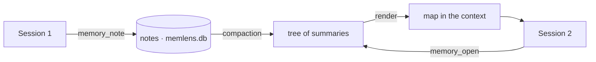

# memlens

English | [中文](https://github.com/knopki/memlens/blob/HEAD/README.zh.md) | [Deutsch](https://github.com/knopki/memlens/blob/HEAD/README.de.md) | [Español](https://github.com/knopki/memlens/blob/HEAD/README.es.md) | [Français](https://github.com/knopki/memlens/blob/HEAD/README.fr.md) | [日本語](https://github.com/knopki/memlens/blob/HEAD/README.ja.md) | [Português](https://github.com/knopki/memlens/blob/HEAD/README.pt.md) | [Русский](https://github.com/knopki/memlens/blob/HEAD/README.ru.md)

**Long-term memory for an agent.** The agent starts each session with a map of what it already
knows. One SQLite file holds the notes, and a tree of summaries stands above them.

<picture>
  <source media="(prefers-color-scheme: dark)" srcset="https://raw.githubusercontent.com/knopki/memlens/HEAD/docs/screenshots/console-overview-dark.png">
  
</picture>

## The problem

An agent forgets between sessions. A new session starts with no fact of the old sessions. A longer
chat is not a memory: each token costs, and the model still loses the start. The loss shows on a
project that lasts weeks: the agent asks again for a decision, and it repeats a mistake that you
already fixed.

## The idea

memlens keeps a notebook for the agent.

1. The agent writes a note: one fact in 384 characters, for example a decision or a trap. A note has
   a scope, for example `project:acme/billing`.
2. The store folds two neighbouring notes into one line. Two lines become one line again. A line
   stands in for its notes for weeks or years.
3. At the session start the agent gets a map. The map holds one line for each scope, and the frontier
   of the current scope from the oldest range to the newest note.
4. The agent opens a line that it needs. A summary opens into the two lines below it. A note opens
   word for word, with its longform document.

A read costs no model call. A note costs one model call in its life, when the tree merges it.



## What you get

- **A small context that stays small.** You give the map a budget in lines. Ten notes and ten
  thousand notes give a map of the same size.
- **Reads without a model call.** `memory_find` uses the SQLite full text search. `memory_open` reads
  one row. The model answers only when the tree merges two notes.
- **Notes, not messages.** Each entry is a fact, a decision, a preference, a task, or a gotcha. The
  agent curates the notes, so the map holds no chat noise.
- **A wrong fact is a one-line edit.** The console lists the notes that are due for review. You amend
  a note, hide it, or redact it for good.
- **One file, no server.** The store is one SQLite file. The command `memlens check` reports the
  health of the file, and `memlens repair` rebuilds the caches from the rows.
- **Each agent sees its own scopes.** A profile gives a set of scopes and a budget. A read or a write
  outside the profile gives an error, so one project cannot read the notes of another.
- **Three frontends on one store.** The harness plugin, the terminal, and the browser console read
  and write the same file.

## A session

The map is one `<memory>` section in the context of the agent. This example comes from a memory of
seven scopes. The policy part and the other scope lines are cut here:

```text
<memory>
…
<directions>
[project:acme/billing] 7d Billing runs an in-house invoice engine behind Stripe, prices in
price_book, and idempotency by invoice id. A trial ends at 23:59 in the customer zone. …
[work:ip] 3d The client pays on the 10th, and the invoice goes out on the 1st. The patent tax
rate is 6 percent, not 13. …
…
</directions>
<here scope="project:acme/billing">
#16-17 2026-09-18..22 The pilot started on 2026-09-15 with 3 customers.; A trial ends at 23:59
in the customer time zone, not in UTC.
#18 2026-09-24 A trial that ends on a Sunday starts dunning on Monday.
#19 2026-09-29 Stripe declines a card on a soft decline for 7 days.
#20 2026-10-02 Write the reconciliation script for the September close.
</here>
</memory>
```

The agent reads the map at the start. It then searches, opens the lines that it needs, and writes new
notes as the work goes. An address is a scope and a slot, for example `project:acme/billing#19`. The
command `memlens open` gives the note word for word, with its whole longform document.

```console
$ memlens find "stripe"
project:acme/billing#19  2026-09-29  fact  Stripe declines a card on a soft decline for 7 days.
project:acme/billing#0  2026-08-04  decision  Stripe is the payment provider, and the invoice engine stays in house.
project:acme/billing#1  2026-08-05  gotcha  Stripe webhook retries arrive out of order, so the handler keys on the event id.
project:acme/billing#7  2026-08-21  decision  Every write to Stripe carries an idempotency key with the invoice id.

$ memlens open project:acme/billing#7
project:acme/billing#7  2026-08-21  decision  review 2027-11-25
Every write to Stripe carries an idempotency key with the invoice id.
--- longform 461 chars ---
# Idempotency on every Stripe write
…
```

## Use it in DeepSeek Harness

The map and the tools reach the agent through the plugin
[`@memlens/dsh-plugin`](https://www.npmjs.com/package/@memlens/dsh-plugin). The store alone gives an
agent nothing. Add the plugin to the profile of the host:

```sh
dsh plugin --profile web add @memlens/dsh-plugin
```

The plugin gives the harness five parts:

- **The map.** The session starts with the `<memory>` section of the profile.
- **The tools.** The agent reads, writes, and reviews the notes with them.
- **The nudge.** After 10 tool calls or 10 turns, the harness reminds the agent to save a note.
- **The worker.** The worker merges the dirty ranges through a model route of the harness.
- **The console.** The same client opens in the side panel and in a session tab.

### The tools

| Tool            | Action                                                                  |
| --------------- | ----------------------------------------------------------------------- |
| `memory_find`   | Search by words, with a limit by date, kind, or scope.                   |
| `memory_open`   | Open a note by its address, or a summary into the two lines below it.    |
| `memory_note`   | Save one note.                                                          |
| `memory_map`    | List the scopes, or give the frontier of one scope.                     |
| `memory_review` | Give the notes that are due for review, or mark them as reviewed.       |
| `memory_forget` | Hide a note. The slot and the content stay, and the note leaves the map. |

The tool `memory_note` also answers a repeat: a write that matches a live note gives that note, not a
second row. A subagent writes a proposal instead of a live note, and a human accepts the proposal in
the console. The default mode of a subagent is `propose`. The mode `read` gives the reading tools
only, and the mode `off` gives no memory.

### The two entries

The package holds two entries. A profile mounts the host row, and an agent preset mounts the preset
row:

| Row             | Package                    | Role                                                       |
| --------------- | -------------------------- | ---------------------------------------------------------- |
| `memlens`       | `@memlens/dsh-plugin`      | The store, the tools, the map, the nudge, and the worker.   |
| `memlens/preset`| `@memlens/dsh-plugin/preset` | The memory profile of one agent preset: the scopes and the budget. |

An agent preset mounts the preset row to select its own profile and budget. Without the row, the
agent uses the profile that `defaultProfile` names.

The compaction needs a model route, and the plugin never picks a model. The keys `provider` and
`model` of the host row give that route:

```yaml
- insert:
    - id: memlens
      name: "@memlens/dsh-plugin"
      config:
        compaction:
          provider: deepseek-official
          model: deepseek-flash
```

The plugin reads the same `config.toml` as the CLI. The plugin row overrides the base file, and the
preset row overrides the plugin row. See each key, default, and example in
[packages/dsh-plugin/README.md](https://github.com/knopki/memlens/blob/HEAD/packages/dsh-plugin/README.md).

## Use it in a terminal

```sh
npm install -g @memlens/cli
```

The install of [`@memlens/cli`](https://www.npmjs.com/package/@memlens/cli) gives the `memlens`
binary. Write a note, find it, and read the map:

```sh
memlens note "The billing database is Postgres 16." --scope project:acme/billing
memlens find "database"
memlens slice
```

The command `npx @memlens/cli@latest` runs the same binary with no install:

```sh
npx @memlens/cli@latest find "database"
```

The store is one `memlens.db` file in the data directory of the platform. The flag `--store` and the
variable `MEMLENS_STORE` select another directory. The CLI and the plugin use the same store, so the
terminal reads the notes of a live session.

## The console

```sh
memlens ui
```

The console opens on `http://127.0.0.1:7788`. It shows the scopes, the tree of one scope, the full
text search, the review queue, the proposals of subagents, and the worker journal.

<picture>
  <source media="(prefers-color-scheme: dark)" srcset="https://raw.githubusercontent.com/knopki/memlens/HEAD/docs/screenshots/console-review-dark.png">
  
</picture>

The same client opens inside DeepSeek Harness, as a side panel and a session tab.

## The commands

| Command              | Action                                                |
| -------------------- | ----------------------------------------------------- |
| `memlens note`       | Save one note.                                        |
| `memlens find`       | Search the notes by words.                            |
| `memlens open`       | Read one note, or the two lines below a summary.      |
| `memlens slice`      | Print the map that the agent gets.                    |
| `memlens review`     | List the notes that are due, or mark them as reviewed. |
| `memlens compact`    | Start a tree build, or apply one answer file.          |
| `memlens ui`         | Start the console.                                    |

The CLI also gives `amend`, `forget`, `restore`, `redact`, `move`, `import`, `export`, `check`,
`repair`, `journal`, and `status`. See [docs/architecture.md](https://github.com/knopki/memlens/blob/HEAD/docs/architecture.md).

## Configuration

memlens works with no configuration file. To change a value, copy the parts that you want into the
base file:

| Platform | Configuration file                                  | Store file                                         |
| -------- | --------------------------------------------------- | -------------------------------------------------- |
| Linux    | `~/.config/memlens/config.toml`                     | `~/.local/share/memlens/memlens.db`                |
| macOS    | `~/Library/Application Support/memlens/config.toml` | `~/Library/Application Support/memlens/memlens.db` |
| Windows  | `%APPDATA%\memlens\config.toml`                     | `%LOCALAPPDATA%\memlens\memlens.db`                |

An absolute `XDG_CONFIG_HOME` or `XDG_DATA_HOME` overrides the paths of Linux.

```toml
defaultProfile = "default"

[profile.default]
scopes = ["*"]

[profile.default.budget]
here = 20
directions = 10
```

The key `here` gives the lines of the current scope. The key `directions` gives the lines of the
scope list. The DSH plugin reads the same file and adds two layers of its own. The command
`memlens config show` prints the resolved values, and it writes no file. See each key, default, and
example in [docs/configuration.md](https://github.com/knopki/memlens/blob/HEAD/docs/configuration.md).

## Why not a chat log

| Need          | A chat history          | A vector store            | memlens                                  |
| ------------- | ----------------------- | ------------------------- | ---------------------------------------- |
| Context cost  | Grows with the chat     | A few chunks for a query  | One line for each scope, within a budget |
| Recall        | The exact words, until the model loses them | Similar text, no order | The exact words by address, with a date |
| Curation      | None                    | None                      | The agent writes, and you review         |
| A wrong fact  | Stays in the log        | Stays in the index        | You hide it or redact it                 |

memlens keeps no embeddings and no vector index. The search stays lexical (SQLite FTS5), and a note
is a curated fact. The store needs no server, no network, and no GPU.

## Status

The core library, the CLI, the console, and the DSH plugin are ready, and the checks of the
repository pass. The compaction needs a model: the plugin sends the merge calls through the harness,
and the CLI waits for an answer file from `memlens compact`.

The source is on [GitHub](https://github.com/knopki/memlens). See [AGENTS.md](https://github.com/knopki/memlens/blob/HEAD/AGENTS.md) for the
build, the tests, and the work rules of the repository.

## Documents

| File                                       | Content                               |
| ------------------------------------------ | ------------------------------------- |
| [docs/architecture.md](https://github.com/knopki/memlens/blob/HEAD/docs/architecture.md) | How the system works.               |
| [docs/configuration.md](https://github.com/knopki/memlens/blob/HEAD/docs/configuration.md) | The configuration format and examples. |
| [packages/dsh-plugin/README.md](https://github.com/knopki/memlens/blob/HEAD/packages/dsh-plugin/README.md) | The plugin of DeepSeek Harness. |
| [docs/features](https://github.com/knopki/memlens/blob/HEAD/docs/features/README.md)   | Cross-module behavior as scenarios.   |
| [docs/arch/README.md](https://github.com/knopki/memlens/blob/HEAD/docs/arch/README.md) | The architecture model as diagrams.   |
| [AGENTS.md](https://github.com/knopki/memlens/blob/HEAD/AGENTS.md)                     | Work rules for agents.                |

## License

MIT. See [LICENSE](https://github.com/knopki/memlens/blob/HEAD/LICENSE).
