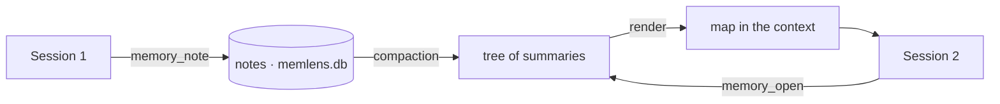
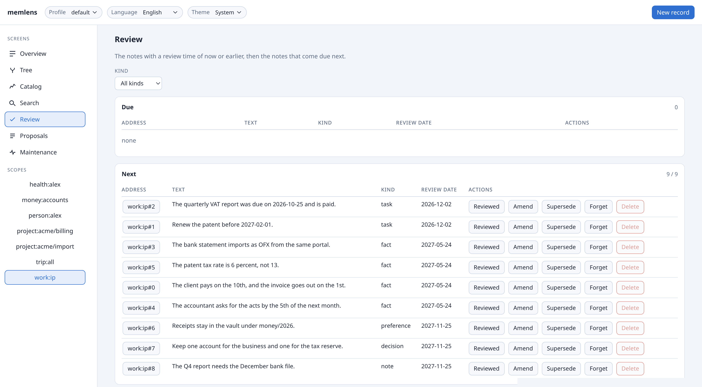

# memlens

[English](https://github.com/knopki/memlens/blob/HEAD/README.md) | [中文](https://github.com/knopki/memlens/blob/HEAD/README.zh.md) | [Deutsch](https://github.com/knopki/memlens/blob/HEAD/README.de.md) | [Español](https://github.com/knopki/memlens/blob/HEAD/README.es.md) | [Français](https://github.com/knopki/memlens/blob/HEAD/README.fr.md) | [日本語](https://github.com/knopki/memlens/blob/HEAD/README.ja.md) | [Português](https://github.com/knopki/memlens/blob/HEAD/README.pt.md) | Русский

**Долговременная память для агента.** Каждую сессию агент начинает с карты того, что уже знает. Один
файл SQLite держит заметки, а над ними стоит дерево сводок.

<picture>
  <source media="(prefers-color-scheme: dark)" srcset="https://raw.githubusercontent.com/knopki/memlens/HEAD/docs/screenshots/console-overview-dark.png">
  
</picture>

## Проблема

Агент забывает между сессиями. Новая сессия начинается без единого факта из прошлых сессий. Длинная
переписка не память: каждый токен стоит денег, а модель всё равно теряет начало. Потеря видна на
проекте, который длится недели: агент снова спрашивает про уже принятое решение и повторяет ошибку,
которую ты уже исправил.

## Идея

memlens ведёт блокнот для агента.

1. Агент пишет заметку: один факт в 384 символа, например решение или ловушку. У заметки есть
   область, например `project:acme/billing`.
2. Хранилище сворачивает две соседние заметки в одну строку. Две строки снова становятся одной
   строкой. Одна строка заменяет свои заметки на недели или годы.
3. В начале сессии агент получает карту. Карта держит по строке на каждую область и фронтир текущей
   области, от самого старого диапазона до самой новой заметки.
4. Агент открывает нужную строку. Сводка раскрывается в две строки под ней. Заметка открывается
   дословно, вместе со своим документом longform.

Чтение не стоит ни одного вызова модели. Заметка стоит одного вызова модели за всю свою жизнь, когда
дерево сводит её.



## Что ты получаешь

- **Маленький контекст, который остаётся маленьким.** Ты задаёшь карте бюджет в строках. Десять
  заметок и десять тысяч заметок дают карту одного размера.
- **Чтения без вызова модели.** `memory_find` использует полнотекстовый поиск SQLite. `memory_open`
  читает одну строку. Модель отвечает только тогда, когда дерево сводит две заметки.
- **Заметки, а не сообщения.** Каждая запись — это факт, решение, предпочтение, задача или ловушка.
  Агент курирует заметки, поэтому в карте нет шума переписки.
- **Неверный факт правится одной строкой.** Консоль перечисляет заметки, которым пора на проверку.
  Ты исправляешь заметку, скрываешь её или стираешь навсегда.
- **Один файл, без сервера.** Хранилище — один файл SQLite. Команда `memlens check` сообщает
  о состоянии файла, а `memlens repair` пересобирает кэши из строк.
- **Каждый агент видит свои области.** Профиль даёт набор областей и бюджет. Чтение или запись за
  пределами профиля дают ошибку, поэтому один проект не прочитает заметки другого.
- **Три фронтенда на одном хранилище.** Плагин harness, терминал и консоль браузера читают и пишут
  один и тот же файл.

## Сессия

Карта — это один раздел `<memory>` в контексте агента. Пример взят из памяти с семью областями.
Часть с политикой и строки других областей здесь вырезаны:

```text
<memory>
…
<directions>
[project:acme/billing] 7d Billing runs an in-house invoice engine behind Stripe, prices in
price_book, and idempotency by invoice id. A trial ends at 23:59 in the customer zone. …
[work:ip] 3d The client pays on the 10th, and the invoice goes out on the 1st. The patent tax
rate is 6 percent, not 13. …
…
</directions>
<here scope="project:acme/billing">
#16-17 2026-09-18..22 The pilot started on 2026-09-15 with 3 customers.; A trial ends at 23:59
in the customer time zone, not in UTC.
#18 2026-09-24 A trial that ends on a Sunday starts dunning on Monday.
#19 2026-09-29 Stripe declines a card on a soft decline for 7 days.
#20 2026-10-02 Write the reconciliation script for the September close.
</here>
</memory>
```

Агент читает карту в начале. Дальше он ищет, открывает нужные строки и пишет новые заметки
по ходу работы. Адрес — это область и слот, например `project:acme/billing#19`. Команда
`memlens open` выдаёт заметку дословно, вместе со всем её документом longform.

```console
$ memlens find "stripe"
project:acme/billing#19  2026-09-29  fact  Stripe declines a card on a soft decline for 7 days.
project:acme/billing#0  2026-08-04  decision  Stripe is the payment provider, and the invoice engine stays in house.
project:acme/billing#1  2026-08-05  gotcha  Stripe webhook retries arrive out of order, so the handler keys on the event id.
project:acme/billing#7  2026-08-21  decision  Every write to Stripe carries an idempotency key with the invoice id.

$ memlens open project:acme/billing#7
project:acme/billing#7  2026-08-21  decision  review 2027-11-25
Every write to Stripe carries an idempotency key with the invoice id.
--- longform 461 chars ---
# Idempotency on every Stripe write
…
```

## Использование в DeepSeek Harness

Карта и инструменты попадают к агенту через плагин
[`@memlens/dsh-plugin`](https://www.npmjs.com/package/@memlens/dsh-plugin). Само хранилище агенту
ничего не даёт. Добавь плагин в профиль хоста:

```sh
dsh plugin --profile web add @memlens/dsh-plugin
```

Плагин даёт harness пять частей:

- **Карта.** Сессия начинается с раздела `<memory>` профиля.
- **Инструменты.** Агент читает, пишет и проверяет заметки через них.
- **Напоминание.** После 10 вызовов инструментов или 10 ходов harness напоминает агенту сохранить
  заметку.
- **Работник.** Работник сводит грязные диапазоны через маршрут модели harness.
- **Консоль.** Тот же клиент открывается в боковой панели и во вкладке сессии.

### Инструменты

| Инструмент      | Действие                                                                |
| --------------- | ----------------------------------------------------------------------- |
| `memory_find`   | Поиск по словам, с ограничением по дате, виду или области.              |
| `memory_open`   | Открыть заметку по её адресу или сводку в две строки под ней.           |
| `memory_note`   | Сохранить одну заметку.                                                 |
| `memory_map`    | Перечислить области или отдать фронтир одной области.                   |
| `memory_review` | Отдать заметки, которым пора на проверку, или отметить их проверенными. |
| `memory_forget` | Скрыть заметку. Слот и содержимое остаются, а заметка уходит из карты.  |

Инструмент `memory_note` отвечает и на повтор: запись, совпавшая с живой заметкой, отдаёт эту
заметку, а не вторую строку. Дочерний агент пишет предложение вместо живой заметки, и человек
принимает предложение в консоли. Режим дочернего агента по умолчанию: `propose`. Режим `read` даёт
только инструменты чтения, а режим `off` не даёт памяти.

### Две точки входа

Пакет держит две точки входа. Профиль монтирует строку хоста, а пресет агента монтирует
строку пресета:

| Строка           | Пакет                        | Роль                                                    |
| ---------------- | ---------------------------- | ------------------------------------------------------- |
| `memlens`        | `@memlens/dsh-plugin`        | Хранилище, инструменты, карта, напоминание и работник.  |
| `memlens/preset` | `@memlens/dsh-plugin/preset` | Профиль памяти одного пресета агента: области и бюджет. |

Пресет агента монтирует строку пресета, чтобы выбрать свой профиль и бюджет. Без строки агент
использует профиль, который называет `defaultProfile`.

Уплотнению нужен маршрут модели, и плагин никогда не выбирает модель сам. Ключи `provider` и `model`
строки хоста задают этот маршрут:

```yaml
- insert:
    - id: memlens
      name: "@memlens/dsh-plugin"
      config:
        compaction:
          provider: deepseek-official
          model: deepseek-flash
```

Плагин читает тот же `config.toml`, что и CLI. Строка плагина переопределяет базовый файл, а строка
пресета переопределяет строку плагина. Каждый ключ, его значение по умолчанию и пример смотри в
[packages/dsh-plugin/README.md](https://github.com/knopki/memlens/blob/HEAD/packages/dsh-plugin/README.md).

## Использование в терминале

```sh
npm install -g @memlens/cli
```

Установка [`@memlens/cli`](https://www.npmjs.com/package/@memlens/cli) даёт бинарник `memlens`.
Напиши заметку, найди её и прочитай карту:

```sh
memlens note "The billing database is Postgres 16." --scope project:acme/billing
memlens find "database"
memlens slice
```

Команда `npx @memlens/cli@latest` запускает тот же бинарник без установки:

```sh
npx @memlens/cli@latest find "database"
```

Хранилище — один файл `memlens.db` в каталоге данных платформы. Флаг `--store` и переменная
`MEMLENS_STORE` выбирают другой каталог. CLI и плагин используют одно хранилище, поэтому терминал
читает заметки живой сессии.

## Консоль

```sh
memlens ui
```

Консоль открывается на `http://127.0.0.1:7788`. Она показывает области, дерево одной области,
полнотекстовый поиск, очередь проверки, предложения дочерних агентов и журнал работника.

<picture>
  <source media="(prefers-color-scheme: dark)" srcset="https://raw.githubusercontent.com/knopki/memlens/HEAD/docs/screenshots/console-review-dark.png">
  
</picture>

Тот же клиент открывается внутри DeepSeek Harness, как боковая панель и вкладка сессии.

## Команды

| Команда           | Действие                                                         |
| ----------------- | ---------------------------------------------------------------- |
| `memlens note`    | Сохранить одну заметку.                                          |
| `memlens find`    | Искать заметки по словам.                                        |
| `memlens open`    | Прочитать одну заметку или две строки под сводкой.               |
| `memlens slice`   | Напечатать карту, которую получает агент.                        |
| `memlens review`  | Перечислить заметки, которым пора, или отметить их проверенными. |
| `memlens compact` | Запустить сборку дерева или применить один файл с ответом.       |
| `memlens ui`      | Запустить консоль.                                               |

CLI даёт ещё `amend`, `forget`, `restore`, `redact`, `move`, `import`, `export`, `check`, `repair`,
`journal` и `status`. Смотри [docs/architecture.md](https://github.com/knopki/memlens/blob/HEAD/docs/architecture.md).

## Конфигурация

memlens работает без файла конфигурации. Чтобы изменить значение, скопируй нужные части в базовый
файл:

| Платформа | Файл конфигурации                                   | Файл хранилища                                     |
| --------- | --------------------------------------------------- | -------------------------------------------------- |
| Linux     | `~/.config/memlens/config.toml`                     | `~/.local/share/memlens/memlens.db`                |
| macOS     | `~/Library/Application Support/memlens/config.toml` | `~/Library/Application Support/memlens/memlens.db` |
| Windows   | `%APPDATA%\memlens\config.toml`                     | `%LOCALAPPDATA%\memlens\memlens.db`                |

Абсолютный `XDG_CONFIG_HOME` или `XDG_DATA_HOME` переопределяет пути Linux.

```toml
defaultProfile = "default"

[profile.default]
scopes = ["*"]

[profile.default.budget]
here = 20
directions = 10
```

Ключ `here` задаёт число строк текущей области. Ключ `directions` задаёт число строк списка
областей. Плагин DSH читает тот же файл и добавляет два своих слоя. Команда `memlens config show`
печатает итоговые значения и не пишет ни одного файла. Каждый ключ, его значение по умолчанию и
пример смотри в [docs/configuration.md](https://github.com/knopki/memlens/blob/HEAD/docs/configuration.md).

## Почему не журнал переписки

| Потребность    | История переписки                        | Векторное хранилище            | memlens                                         |
| -------------- | ---------------------------------------- | ------------------------------ | ----------------------------------------------- |
| Цена контекста | Растёт вместе с перепиской               | Несколько фрагментов на запрос | По строке на каждую область, в пределах бюджета |
| Припоминание   | Точные слова, пока модель их не потеряет | Похожий текст, без порядка     | Точные слова по адресу, с датой                 |
| Курирование    | Нет                                      | Нет                            | Агент пишет, ты проверяешь                      |
| Неверный факт  | Остаётся в журнале                       | Остаётся в индексе             | Ты скрываешь его или стираешь                   |

memlens не держит эмбеддингов и векторного индекса. Поиск остаётся лексическим (SQLite FTS5), а
заметка — это курированный факт. Хранилищу не нужны ни сервер, ни сеть, ни GPU.

## Состояние

Библиотека ядра, CLI, консоль и плагин DSH готовы, проверки репозитория проходят. Уплотнению нужна
модель: плагин отправляет вызовы сведения через harness, а CLI ждёт файл с ответом от
`memlens compact`.

Исходники на [GitHub](https://github.com/knopki/memlens). Сборка, тесты и правила работы в
репозитории — в [AGENTS.md](https://github.com/knopki/memlens/blob/HEAD/AGENTS.md).

## Документы

| Файл                                                           | Содержимое                                 |
| -------------------------------------------------------------- | ------------------------------------------ |
| [docs/architecture.md](https://github.com/knopki/memlens/blob/HEAD/docs/architecture.md)                   | Как устроена система.                      |
| [docs/configuration.md](https://github.com/knopki/memlens/blob/HEAD/docs/configuration.md)                 | Формат конфигурации и примеры.             |
| [packages/dsh-plugin/README.md](https://github.com/knopki/memlens/blob/HEAD/packages/dsh-plugin/README.md) | Плагин DeepSeek Harness.                   |
| [docs/features](https://github.com/knopki/memlens/blob/HEAD/docs/features/README.md)                       | Поведение между модулями в виде сценариев. |
| [docs/arch/README.md](https://github.com/knopki/memlens/blob/HEAD/docs/arch/README.md)                     | Модель архитектуры в виде диаграмм.        |
| [AGENTS.md](https://github.com/knopki/memlens/blob/HEAD/AGENTS.md)                                         | Правила работы для агентов.                |

## Лицензия

MIT. Смотри [LICENSE](https://github.com/knopki/memlens/blob/HEAD/LICENSE).
