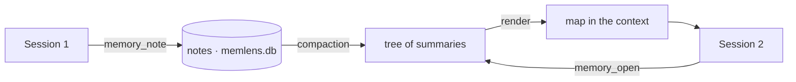

# memlens

[English](https://github.com/knopki/memlens/blob/HEAD/README.md) | 中文 | [Deutsch](https://github.com/knopki/memlens/blob/HEAD/README.de.md) | [Español](https://github.com/knopki/memlens/blob/HEAD/README.es.md) | [Français](https://github.com/knopki/memlens/blob/HEAD/README.fr.md) | [日本語](https://github.com/knopki/memlens/blob/HEAD/README.ja.md) | [Português](https://github.com/knopki/memlens/blob/HEAD/README.pt.md) | [Русский](https://github.com/knopki/memlens/blob/HEAD/README.ru.md)

**智能体的长期记忆。** 智能体在每个会话开始时拿到一张地图，上面是它已经知道的东西。一个 SQLite 文件持有笔记，笔记上方立着一棵摘要树。

<picture>
  <source media="(prefers-color-scheme: dark)" srcset="https://raw.githubusercontent.com/knopki/memlens/HEAD/docs/screenshots/console-overview-dark.png">
  
</picture>

## 问题

智能体在会话之间遗忘。新会话开始时，旧会话的事实一条也没有。更长的聊天不是记忆：每个 token 都有成本，模型还是会丢掉开头。这种损失在持续数周的项目上显现：智能体再次询问一个已经定下的决策，还重复一个你已经修掉的错误。

## 思路

memlens 为智能体保存一本笔记本。

1. 智能体写一条笔记：384 字符以内的一条事实，例如一个决策或一个陷阱。一条笔记有一个范围，例如 `project:acme/billing`。
2. 存储把两条相邻的笔记折成一行。两行再折成一行。一行在数周或数年内代表它的笔记。
3. 会话开始时，智能体拿到一张地图。地图为每个范围持有一行，还持有当前范围的前沿，从最旧的区间到最新的笔记。
4. 智能体打开它需要的一行。摘要展开成它下面的两行。笔记逐字打开，连同它的 longform 文档。

一次读取不产生模型调用。一条笔记在其一生中只花一次模型调用：树合并它的时候。



## 你得到什么

- **始终很小的上下文。** 你给地图一份以行计的预算。十条笔记和一万条笔记给出的地图一样大。
- **不产生模型调用的读取。** `memory_find` 使用 SQLite 全文搜索。`memory_open` 读取一行。只有当树合并两条笔记时，模型才作答。
- **笔记，不是消息。** 每条记录是一条事实、一个决策、一个偏好、一个任务或一个陷阱。智能体整理笔记，因此地图里没有聊天噪音。
- **一条错的事实只需改一行。** 控制台列出到期待复核的笔记。你修改一条笔记、隐藏它，或永久抹除它。
- **一个文件，没有服务器。** 存储是一个 SQLite 文件。命令 `memlens check` 报告文件的健康状况，`memlens repair` 从记录行重建缓存。
- **每个智能体只看到自己的范围。** 配置档给出一组范围和一份预算。配置档之外的读取或写入返回错误，因此一个项目读不到另一个项目的笔记。
- **三个前端共用一个存储。** harness 插件、终端和浏览器控制台读写同一个文件。

## 一个会话

地图是智能体上下文里的一个 `<memory>` 节。这个例子来自一份有七个范围的记忆。这里省略了策略部分和其余范围的行：

```text
<memory>
…
<directions>
[project:acme/billing] 7d Billing runs an in-house invoice engine behind Stripe, prices in
price_book, and idempotency by invoice id. A trial ends at 23:59 in the customer zone. …
[work:ip] 3d The client pays on the 10th, and the invoice goes out on the 1st. The patent tax
rate is 6 percent, not 13. …
…
</directions>
<here scope="project:acme/billing">
#16-17 2026-09-18..22 The pilot started on 2026-09-15 with 3 customers.; A trial ends at 23:59
in the customer time zone, not in UTC.
#18 2026-09-24 A trial that ends on a Sunday starts dunning on Monday.
#19 2026-09-29 Stripe declines a card on a soft decline for 7 days.
#20 2026-10-02 Write the reconciliation script for the September close.
</here>
</memory>
```

智能体在开始时读地图。之后它搜索、打开需要的行，并在工作中写新笔记。一个地址是一个范围加一个槽位，例如 `project:acme/billing#19`。命令 `memlens open` 逐字给出笔记，连同它完整的 longform 文档。

```console
$ memlens find "stripe"
project:acme/billing#19  2026-09-29  fact  Stripe declines a card on a soft decline for 7 days.
project:acme/billing#0  2026-08-04  decision  Stripe is the payment provider, and the invoice engine stays in house.
project:acme/billing#1  2026-08-05  gotcha  Stripe webhook retries arrive out of order, so the handler keys on the event id.
project:acme/billing#7  2026-08-21  decision  Every write to Stripe carries an idempotency key with the invoice id.

$ memlens open project:acme/billing#7
project:acme/billing#7  2026-08-21  decision  review 2027-11-25
Every write to Stripe carries an idempotency key with the invoice id.
--- longform 461 chars ---
# Idempotency on every Stripe write
…
```

## 在 DeepSeek Harness 中使用

地图和工具通过插件到达智能体。只有存储时，智能体什么也得不到。把插件加入宿主的配置档：

```sh
dsh plugin --profile web add @memlens/dsh-plugin
```

插件给 harness 五个部分：

- **地图。** 会话以配置档的 `<memory>` 节开始。
- **工具。** 智能体用它们读取、写入和复核笔记。
- **提醒。** 10 次工具调用或 10 轮之后，harness 提醒智能体保存一条笔记。
- **工作进程。** 工作进程通过 harness 的一条模型路由合并脏区间。
- **控制台。** 同一个客户端在侧边面板和会话标签页里打开。

### 工具

| 工具            | 作用                                                                    |
| --------------- | ----------------------------------------------------------------------- |
| `memory_find`   | 按词语搜索，可按日期、种类或范围限定。                                   |
| `memory_open`   | 按地址打开一条笔记，或把摘要展开成它下面的两行。                         |
| `memory_note`   | 保存一条笔记。                                                          |
| `memory_map`    | 列出各个范围，或给出一个范围的前沿。                                     |
| `memory_review` | 给出到期待复核的笔记，或把它们标记为已复核。                             |
| `memory_forget` | 隐藏一条笔记。槽位和内容保留，笔记离开地图。                             |

工具 `memory_note` 也应对重复：与一条有效笔记匹配的写入给出那条笔记，而不是第二行。子智能体写的是提案，不是有效笔记，由人在控制台接受提案。子智能体的默认模式是 `propose`。模式 `read` 只给读取工具，模式 `off` 不给记忆。

### 两个入口

这个包有两个入口。配置档挂载宿主行，智能体预设挂载预设行：

| 行              | 包                           | 作用                                                       |
| --------------- | ---------------------------- | ---------------------------------------------------------- |
| `memlens`       | `@memlens/dsh-plugin`        | 存储、工具、地图、提醒和工作进程。                          |
| `memlens/preset`| `@memlens/dsh-plugin/preset` | 一个智能体预设的记忆配置档：范围和预算。                    |

智能体预设挂载预设行，以选择自己的配置档和预算。没有这一行时，智能体使用 `defaultProfile` 指定的配置档。

压缩需要一条模型路由，插件从不自己挑选模型。宿主行的键 `provider` 和 `model` 给出这条路由：

```yaml
- insert:
    - id: memlens
      name: "@memlens/dsh-plugin"
      config:
        compaction:
          provider: deepseek-official
          model: deepseek-flash
```

插件和 CLI 读同一个 `config.toml`。插件行覆盖基础文件，预设行覆盖插件行。每个键、默认值和示例见 [packages/dsh-plugin/README.md](https://github.com/knopki/memlens/blob/HEAD/packages/dsh-plugin/README.md)。

## 在终端中使用

```sh
npm install -g @memlens/cli
```

安装给出 `memlens` 可执行文件。写一条笔记，找到它，再读地图：

```sh
memlens note "The billing database is Postgres 16." --scope project:acme/billing
memlens find "database"
memlens slice
```

命令 `npx @memlens/cli@latest` 无需安装就运行同一个可执行文件：

```sh
npx @memlens/cli@latest find "database"
```

存储是平台数据目录里的一个 `memlens.db` 文件。旗标 `--store` 和变量 `MEMLENS_STORE` 选择另一个目录。CLI 和插件使用同一个存储，因此终端能读到活跃会话的笔记。

## 控制台

```sh
memlens ui
```

控制台打开在 `http://127.0.0.1:7788`。它显示各个范围、一个范围的树、全文搜索、复核队列、子智能体的提案，以及工作进程日志。

<picture>
  <source media="(prefers-color-scheme: dark)" srcset="https://raw.githubusercontent.com/knopki/memlens/HEAD/docs/screenshots/console-review-dark.png">
  
</picture>

同一个客户端也在 DeepSeek Harness 里以侧边面板和会话标签页打开。

## 命令

| 命令                 | 作用                                                  |
| -------------------- | ----------------------------------------------------- |
| `memlens note`       | 保存一条笔记。                                        |
| `memlens find`       | 按词语搜索笔记。                                      |
| `memlens open`       | 读一条笔记，或读摘要下面的两行。                       |
| `memlens slice`      | 打印智能体拿到的地图。                                |
| `memlens review`     | 列出到期的笔记，或把它们标记为已复核。                 |
| `memlens compact`    | 开始一次树构建，或应用一个回答文件。                   |
| `memlens ui`         | 启动控制台。                                          |

CLI 还给出 `amend`、`forget`、`restore`、`redact`、`move`、`import`、`export`、`check`、`repair`、`journal` 和 `status`。见 [docs/architecture.md](https://github.com/knopki/memlens/blob/HEAD/docs/architecture.md)。

## 配置

memlens 没有配置文件也能工作。要修改某个值，把需要的部分复制进基础文件：

| 平台    | 配置文件                                            | 存储文件                                           |
| ------- | --------------------------------------------------- | -------------------------------------------------- |
| Linux   | `~/.config/memlens/config.toml`                     | `~/.local/share/memlens/memlens.db`                |
| macOS   | `~/Library/Application Support/memlens/config.toml` | `~/Library/Application Support/memlens/memlens.db` |
| Windows | `%APPDATA%\memlens\config.toml`                     | `%LOCALAPPDATA%\memlens\memlens.db`                |

绝对的 `XDG_CONFIG_HOME` 或 `XDG_DATA_HOME` 覆盖 Linux 的路径。

```toml
defaultProfile = "default"

[profile.default]
scopes = ["*"]

[profile.default.budget]
here = 20
directions = 10
```

键 `here` 给出当前范围的行。键 `directions` 给出范围列表的行。DSH 插件读同一个文件，并增加自己的两个层。命令 `memlens config show` 打印解析后的值，它不写任何文件。每个键、默认值和示例见 [docs/configuration.md](https://github.com/knopki/memlens/blob/HEAD/docs/configuration.md)。

## 为什么不用聊天记录

| 需求           | 聊天历史                                   | 向量存储                 | memlens                                  |
| -------------- | ------------------------------------------ | ------------------------ | ---------------------------------------- |
| 上下文成本     | 随聊天增长                                 | 一次查询几个片段         | 每个范围一行，在预算之内                 |
| 召回           | 精确的词语，直到模型丢掉它们               | 相似的文本，没有顺序     | 按地址取精确的词语，带日期               |
| 整理           | 无                                         | 无                       | 智能体写，你复核                         |
| 一条错的事实   | 留在日志里                                 | 留在索引里               | 你隐藏它或抹除它                         |

memlens 不保存嵌入，也不建向量索引。搜索保持词法（SQLite FTS5），笔记是经过整理的事实。存储不需要服务器、网络或 GPU。

## 状态

核心库、CLI、控制台和 DSH 插件都已就绪，仓库的检查通过。压缩需要一个模型：插件通过 harness 发送合并调用，CLI 等待 `memlens compact` 的回答文件。

源代码在 [GitHub](https://github.com/knopki/memlens)。构建、测试和仓库的工作规则见 [AGENTS.md](https://github.com/knopki/memlens/blob/HEAD/AGENTS.md)。

## 文档

| 文件                                                         | 内容                                 |
| ------------------------------------------------------------ | ------------------------------------ |
| [docs/architecture.md](https://github.com/knopki/memlens/blob/HEAD/docs/architecture.md)                 | 系统如何工作。                       |
| [docs/configuration.md](https://github.com/knopki/memlens/blob/HEAD/docs/configuration.md)               | 配置格式与示例。                     |
| [packages/dsh-plugin/README.md](https://github.com/knopki/memlens/blob/HEAD/packages/dsh-plugin/README.md) | DeepSeek Harness 的插件。          |
| [docs/features](https://github.com/knopki/memlens/blob/HEAD/docs/features/README.md)                     | 以场景描述的跨模块行为。             |
| [docs/arch/README.md](https://github.com/knopki/memlens/blob/HEAD/docs/arch/README.md)                   | 以图表描述的架构模型。               |
| [AGENTS.md](https://github.com/knopki/memlens/blob/HEAD/AGENTS.md)                                       | 智能体的工作规则。                   |

## 许可证

MIT。见 [LICENSE](https://github.com/knopki/memlens/blob/HEAD/LICENSE)。
