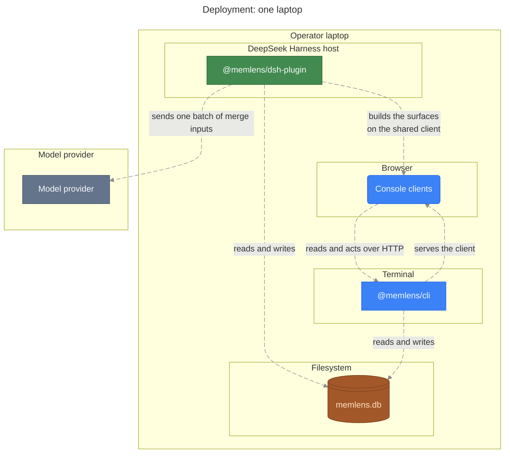
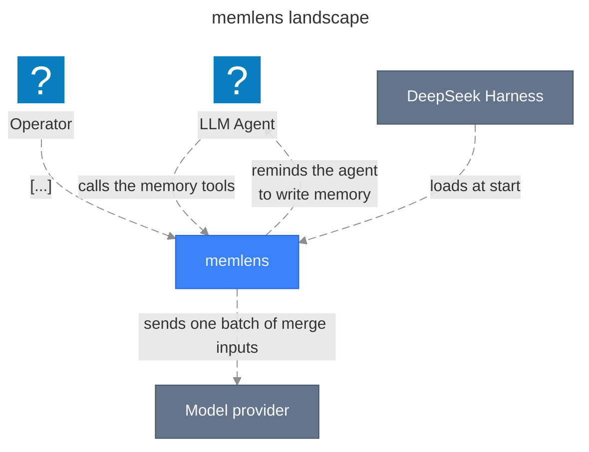
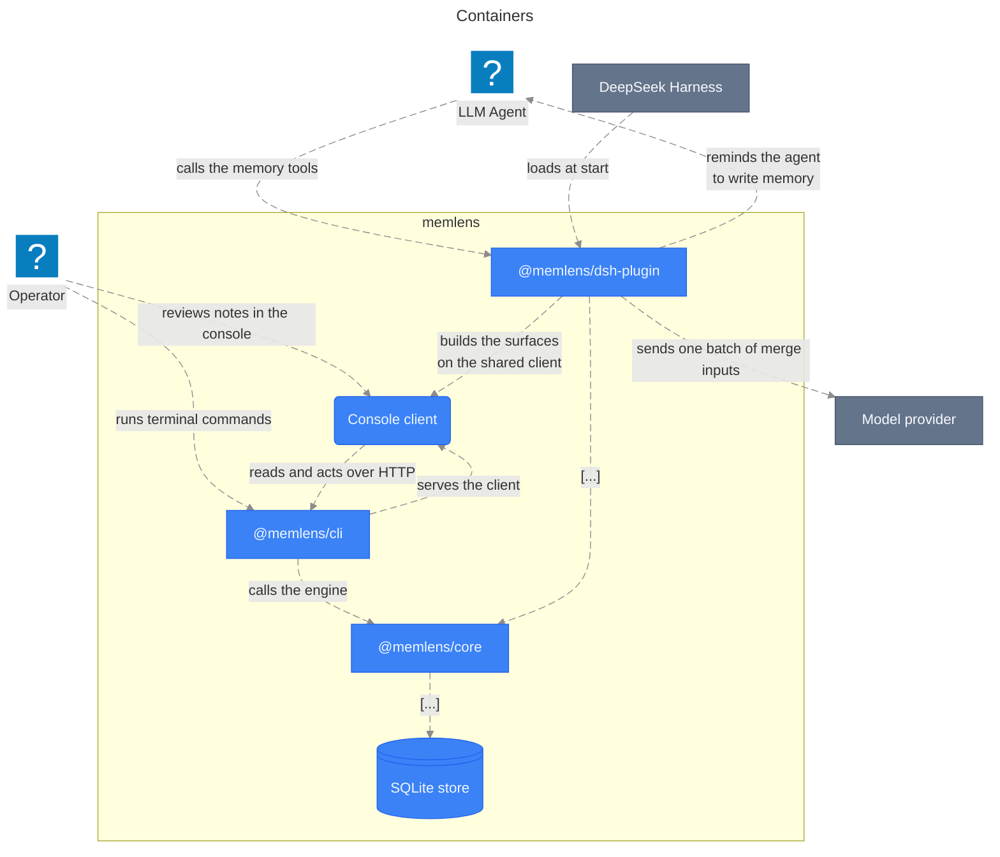
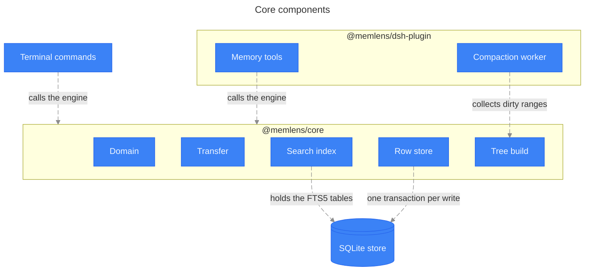
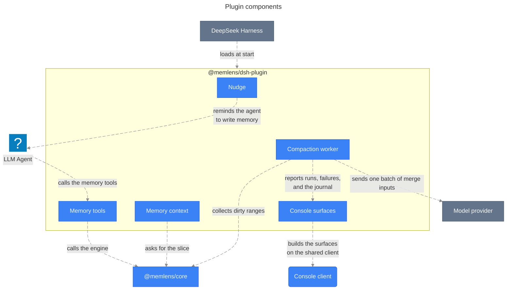
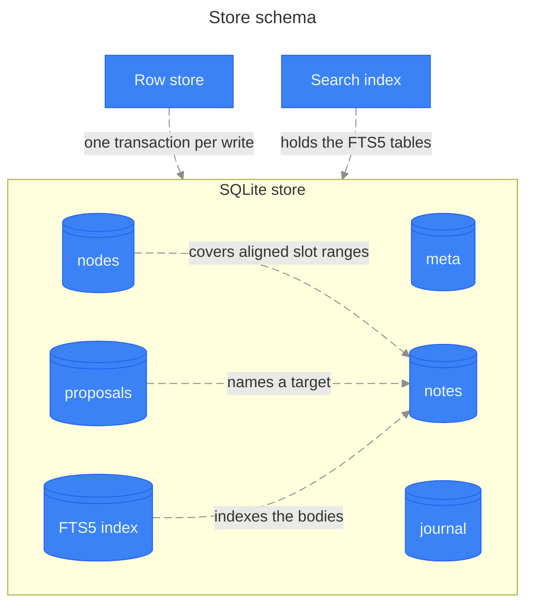
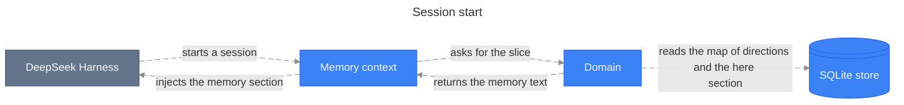
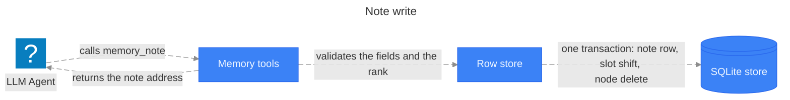
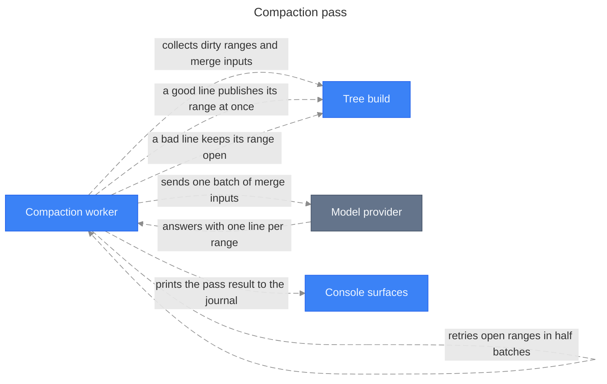

<!-- Generated by likec4 export markdown. Do not edit manually. -->

# memlens architecture

The LikeC4 model of memlens: the context, the containers, the parts of the core and the plugin, the main use cases, and one deployment. Run `pnpm run arch` for the live preview. This file is generated: `pnpm run arch:export` refreshes the diagrams. Module contracts own the local rules.

### Deployment: one laptop

The host and the terminal share one store file. The model provider
sits outside the laptop.

### memlens landscape

The system context. An agent and an operator use the memory.
The host loads the plugin. The model provider serves the compaction calls.

### Containers

The four packages and the store inside memlens. One shared console
client serves two hosts: the CLI standalone console and the plugin
surfaces in the host GUI. The core library depends on nothing.

### Core components

The engine of the memory. The domain holds the rules,
the store holds the rows, the tree builds the summaries.

### Plugin components

The harness surface. The tools serve the agent,
the worker compacts the tree, the consoles serve the operator.

### Store schema

The tables of memlens.db. The schema contract owns the fields.
The index is a cache over the note rows.

### Session start

The host starts a session. The memory context renders the slice
and injects it into the system prompt. A read costs no model call.

### Note write

The agent writes a note. The store ranks the note by its time and id.
A middle insert shifts the later slots. One transaction holds the whole write.

### Compaction pass

The worker runs one pass when the host is idle. It holds no default model:
a missing route fails the pass with a clear error.
See ADR-0023.

